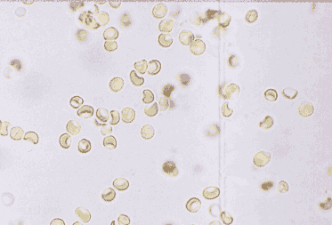
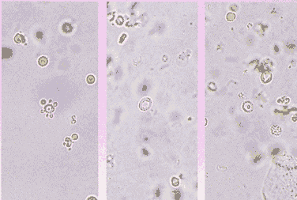
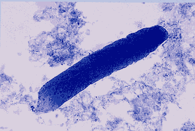
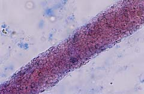
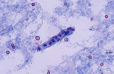
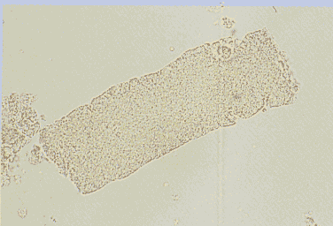
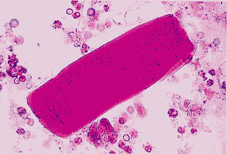
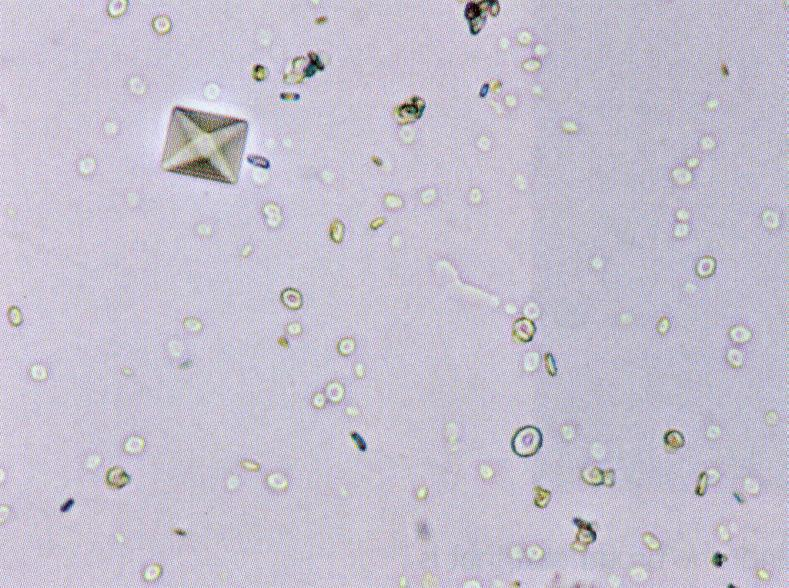
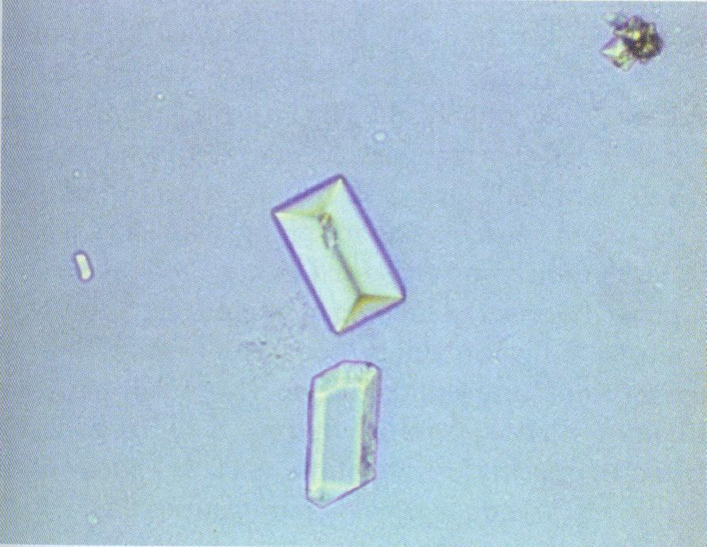
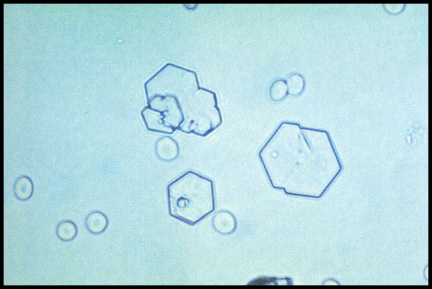

# 体液一般检查：知识梳理与复习

> 依据《体液一般检查(1).ppt》整理，课件内标题为《体液检查》。授课：徐子真，上海交通大学医学院检验系。
> 原文件共 146 张幻灯片，本文“P”按文件顺序计页。整理日期：2026-10-30。
> 本文供课程学习与复习。正文以课件为主；涉及参考区间、方法局限或需要辨析的表述时，明确区分“课件口径”和补充说明。具体检验结果须结合本实验室方法、参考区间与临床情况解释。

## 一、学习主线与检查框架

本课分为四部分：**尿液分析、粪便检验、脑脊液检验、浆膜腔积液检验**。共同的阅读顺序是：先看标本是否合格，再看外观，结合化学结果、细胞形态和必要的病原或细胞学检查。

| 标本 | 主要问题 | 核心检查 | 课件定位 |
| --- | --- | --- | --- |
| 尿液 | 有无泌尿系统病变、代谢异常或浓缩稀释功能异常？ | 理学、干化学、尿沉渣；按需要加培养、定量和细胞学 | P3—103 |
| 粪便 | 有无出血、炎症、消化吸收异常？ | 外观、隐血、脂肪及显微镜检查 | P104—109 |
| 脑脊液 CSF | 感染、出血、炎症或肿瘤累及中枢的证据是什么？ | 压力、外观、细胞、蛋白质、葡萄糖及病原学 | P110—132 |
| 胸水、腹水 | 积液形成机制、炎症或肿瘤证据如何？ | 胸水 Light 标准；腹水 SAAG；细胞分类、培养、细胞学 | P133—144 |

**尿液分析**：对尿液进行理学、化学和显微镜等检查，作为肾脏及尿路疾病的常用初筛，并可间接反映代谢、循环状态。试带筛查与完整尿液分析、尿培养、尿细胞学的目的不同，不能相互替代。

## 二、尿液标本与理学检查（P7—16）

### 2.1 标本类型和保存

| 标本 | 课件主要用途 | 复习要点 |
| --- | --- | --- |
| 晨尿 | 常规筛检、确认、妊娠相关检测等 | 记录采样时间；不同具体检测对取样时段的要求可能不同 |
| 随机尿 | 常规筛查 | 饮水、饮食、运动可影响浓度和结果，必要时复查 |
| 清洁中段尿 | 尿培养等 | 减少外生殖器及尿道前段污染 |
| 导尿标本 | 特定条件下的微生物检查等 | 应按采样规范采集，不能把放置已久的尿袋尿当作等效标本 |
| 12 h／24 h 定时尿 | 定量分析 | 收集完整性、总尿量和保存条件影响结果 |

课件要求常规尿标本尽量在采集后 **2 h 内**完成检测，不能及时检测时按要求冷藏。不同分析项目的保存条件并不完全一致，复检时还应考虑是否需混匀、复温。

| 放置或保存不当 | 变化及机制 |
| --- | --- |
| pH、亚硝酸盐、细菌可升高 | 细菌增殖及代谢改变标本 |
| 葡萄糖可降低 | 细胞或细菌消耗葡萄糖 |
| 酮体、胆红素、尿胆原可降低 | 挥发、氧化或降解等影响；胆红素可氧化为胆绿素，尿胆原可氧化为尿胆素 |
| 细胞、管型可能破坏 | 尤其需考虑稀释、碱性及延迟检测对形态的影响 |

记住：**标本变化可以制造“疾病样结果”，也可以掩盖真实异常。**

### 2.2 颜色、透明度和气味

| 外观 | 课件联系 | 判读限制 |
| --- | --- | --- |
| 淡黄至深黄 | 正常尿色素及浓缩程度等 | 饮水和浓缩状态也会改变颜色 |
| 红色、红褐色 | 红细胞、游离 Hb、Mb、卟啉、食物色素等 | 先排除月经等污染；红尿不能直接等同血尿 |
| 黄褐或黄绿色 | 胆红素、胆绿素等胆汁色素 | 结合尿胆红素、血液及其他检验 |
| 放置后深褐或黑色 | 尿黑酸、血红蛋白氧化或黑素原等 | 课件 alkaptonuria 指尿黑酸尿症，不能按英文拼写误解成“尿液碱化” |
| 浑浊 | 细胞、细菌、结晶、黏液、脂肪、精液或污染物等 | 非病理性结晶也能使尿液浑浊，不能仅凭浑浊诊断感染 |
| 腐败或恶臭 | 细菌增殖、感染或标本久置等 | 气味只能作为线索，不能独立确定病因 |

### 2.3 尿比重、尿渗透压与尿量

**尿比重（SG）**：尿液相对于水的密度，受尿中溶质组成及浓度影响，临床用于粗略了解尿液浓缩、稀释状态。课件列随机尿约 **1.003—1.035**、24 h 尿约 **1.016—1.022**，并非所有采样情境都使用同一范围。

**尿渗透压／质量渗透浓度（osmolality）**：反映单位质量溶剂中溶质颗粒数，规范单位通常为 mOsm/kg H₂O。它与比重反映的物理量不同；葡萄糖、蛋白质等可使两者关系改变，不能把高比重直接解释成肾小管功能完全正常。

课件 P13 将 osmolality 的示例范围写为 500—850 mOsm/L，P14 又使用 mOsm/kg。整理时保留这一单位差异，**不把按体积的渗透浓度与按质量的 osmolality 强行等同**。

**等比重尿**：尿比重反复固定在约 1.010 附近，课件将其与浓缩、稀释能力受损联系。判断需连续观察，单次 1.010 不能直接诊断慢性肾衰竭。

| 项目 | P15 课件口径 | 应如何使用 |
| --- | --- | --- |
| 成人每日尿量 | 600—2000 mL／24 h | 与饮水、体重、出入量及药物等共同解释 |
| 少尿 | ＜400 mL／日 | 属成人课程分级；急性肾损伤评估还需结合体重和持续时间 |
| 多尿 | ＞2500 mL／日 | 课件联系糖尿病、尿崩症、利尿剂、咖啡因和乙醇等 |
| 无尿 | 课件以严重损伤或肾血流减少致尿流停止解释 | 不只考虑肾实质损伤，也需结合灌注及梗阻等可能 |
| 夜间尿量增多 | 课件列夜尿量＞500 mL、比重＜1.018 | 不等同现代术语 nocturia 的完整定义 |

补充辨析：夜尿（nocturia）是主要睡眠期间醒来排尿的表现，与“夜间尿量多”是不同维度，不能单凭 500 mL 给所有人作定义。见 [ICS 夜尿术语说明](https://www.ics.org/committees/standardisation/terminologydiscussions/nocturia)。

## 三、尿液干化学检查（P17—39）

### 3.1 试带法与干扰因素

试纸条各反应垫发生显色，分析仪读取光学变化，与相应标度比较。项目包括 pH、蛋白质、葡萄糖、酮体、隐血、胆红素、尿胆原、亚硝酸盐、白细胞酯酶、比重和抗坏血酸等。

| 项目 | 课件基本原理 | 关键局限 |
| --- | --- | --- |
| pH | 酸碱指示剂 | 饮食、药物、保存及细菌均可影响 |
| 蛋白质 PRO | pH 指示剂的蛋白质误差法 | 对白蛋白较敏感，对球蛋白及轻链不敏感 |
| 葡萄糖 GLU | 葡萄糖氧化酶法 | 常规试带不等于检测所有还原糖 |
| 隐血 BLD | 血红素类过氧化物酶活性 | RBC 内 Hb、游离 Hb、Mb 均可反应 |
| 胆红素 BIL | 偶氮反应 | 光照、氧化及某些干扰物可影响结果 |
| 尿胆原 URO | 醛反应或相应试剂反应 | 方法与干扰随试剂不同 |
| 酮体 KET | 硝基铁氰化钠反应 | 主要检乙酰乙酸，部分配方可检丙酮；不检 β-羟丁酸 |
| 亚硝酸盐 NIT | 检测尿中亚硝酸盐 | 只有部分细菌可将硝酸盐转为亚硝酸盐 |
| 白细胞酯酶 LE | 检测白细胞相关酯酶活性 | 不能等同完整细胞计数或病原诊断 |
| 试带比重 SG | 多聚电解质与离子反应 | 与折射仪等方法反映的因素不同 |
| 抗坏血酸 | 还原性相关反应 | 课件强调可能使 GLU、BLD、BIL 出现假阴性 |

课件中的检测限和灵敏度、特异度属于特定方法或教学示例，不能推广为所有品牌试纸和所有患者的固定性能。

### 3.2 pH、蛋白尿与白蛋白尿

尿 pH 课件范围 **4.6—8.0**。肉食等可使尿偏酸，部分素食等可使尿偏碱；产脲酶细菌可使尿素形成氨，出现碱性及氨味。尿 pH 可提供酸碱排泄线索，但不能单凭它判断全身酸碱状态或确诊肾小管性酸中毒。

**蛋白尿**：尿蛋白排出异常增多的表现。课件列正常总蛋白排出量＜150 mg／日；常规蛋白试带主要反映白蛋白，阴性不能排除轻链或低分子蛋白排泄增多。

| 类型 | 主要机制和蛋白特点 | 课件联系 |
| --- | --- | --- |
| 肾小球性蛋白尿 | 滤过屏障受损，以白蛋白为主 | 肾小球疾病、糖尿病肾病等；可大量，但并非所有肾小球性蛋白尿都达肾病范围 |
| 肾小管性蛋白尿 | 低分子蛋白重吸收障碍 | α₁-微球蛋白、β₂-微球蛋白等增多，联系小管间质损伤 |
| 溢出性蛋白尿 | 血中可滤过蛋白过多 | 免疫球蛋白轻链、Hb、Mb；浆细胞病、血管内溶血或肌肉损伤等 |
| 混合性或泌尿道相关 | 多环节受累，或炎症、出血、分泌物混入 | 不能将全部尿蛋白来源均归于肾小球 |

课件用＞3—4 g／日、＜1 g／日等描述典型量级，这些不是区分病因的绝对界线。**mg/L 是浓度，mg/日是排出量，mg/g 肌酐是比值，三者不能直接互换。**

**白蛋白尿**：尿白蛋白排出增多，可用白蛋白定量或尿白蛋白／肌酐比（ACR）等评估。课件 P24 强调 30 mg／24 h 或约 30 mg/g 肌酐这一量级；需确认持续性，不能凭一次异常直接诊断慢性肾病。

补充：ACR ≥30 mg/g 属肾损伤评估的重要阈值；这与普通总蛋白试带“阳性”不是一回事。见 [KDIGO 2024 CKD 指南](https://kdigo.org/wp-content/uploads/2024/03/KDIGO-2024-CKD-Guideline.pdf)。

### 3.3 葡萄糖与酮体

**糖尿**：尿中葡萄糖增加，可能来自血糖超过重吸收能力，也可能来自肾糖阈或近端小管重吸收改变。必须把尿糖与血糖放在一起解释。

| 组合 | 课件思路 |
| --- | --- |
| 高血糖＋糖尿 | 考虑超过肾糖阈的葡萄糖排泄，糖尿病是重要原因 |
| 血糖正常＋糖尿 | 妊娠、良性肾性糖尿、近端小管功能异常等 |
| 糖尿＋氨基酸尿＋磷酸盐尿 | 联系 Fanconi 综合征的近端小管多种重吸收障碍 |

铜还原法可检测多种还原性物质；葡萄糖氧化酶法主要针对葡萄糖。铜还原法阳性、葡萄糖试带阴性时，不能直接把前者认定为葡萄糖。

**酮体**：包括乙酰乙酸、β-羟丁酸和丙酮，是脂肪代谢相关产物。常规尿酮体试带不检测 β-羟丁酸，故其结果不代表“全部酮体”，不能用一次尿酮阴性排除以 β-羟丁酸升高为主的酮症。

课件联系糖尿病酮症酸中毒，以及饥饿或低碳摄入、呕吐、发热、妊娠等非糖尿病情形。尿酮阳性并不自动等于糖尿病酮症酸中毒。

### 3.4 隐血、血尿、Hb 尿与 Mb 尿

**尿隐血**：试带检测到血红素相关反应，可来自完整 RBC 内的 Hb、游离 Hb 或 Mb。它不是显微镜下直接数红细胞。

**血尿**：尿中有红细胞，可分肉眼可见与仅镜下发现。红尿还需与 Hb 尿、Mb 尿、食物或药物色素及污染鉴别。

| 结果组合 | 主要分析方向 |
| --- | --- |
| 试带隐血阳性＋镜下 RBC 增多 | 支持血尿，再结合形态、管型、蛋白尿与病史定位 |
| 试带隐血阳性＋RBC 少或未见 | 考虑 Hb、Mb，或尿液稀释、碱性、久置导致 RBC 破坏等 |
| 尿色红但试带不相符 | 复核干扰、污染与非血红素色素等可能 |

补充：不能仅用试带阳性定义镜下血尿，应进行尿显微镜检查确认。见 [AUA/SUFU 2025 镜下血尿指南](https://www.auanet.org/documents/Guidelines/PDF/2025%20Guidelines/MH%20Unabridged%2002.2025FINAL4.pdf)。

**血红蛋白尿**：游离血红蛋白进入尿中，课件联系血管内溶血等。可结合血浆溶血表现、触珠蛋白等判断，不能与所有红尿等同。

**肌红蛋白尿**：肌红蛋白进入尿中，课件联系肌肉损伤、横纹肌溶解和过量运动等；CK 增高可提供肌肉来源线索。P32 的 CK 倍数为教学示例，不作为区分 Hb 与 Mb 的通用硬阈值。

含铁血黄素尿可与肾小管处理血红蛋白相关，课件介绍普鲁士蓝染色。Hb 尿、Mb 尿和完整红细胞形成的血尿，检查对象不同。

### 3.5 胆红素与尿胆原

**尿胆红素**：主要检测水溶性结合胆红素；未结合胆红素与白蛋白结合且不溶于水，不能照此途径从尿排出。胆红素尿需结合肝细胞损伤或胆道梗阻等解释。

**尿胆原**：胆红素经肠道代谢、再吸收后，其中一部分由尿排出。其结果与尿胆红素的组合，比单独看一项更有鉴别价值。

| 典型情况 | 尿胆红素 | 尿胆原 | 其他课件线索 |
| --- | --- | --- | --- |
| 溶血性／肝前性黄疸 | 通常阴性 | 常增多 | 未结合胆红素增加，粪色可加深 |
| 肝细胞性黄疸 | 可阳性 | 可增多或随病程变化 | 合成、摄取、结合和排泄多个环节受影响 |
| 胆道梗阻 | 常阳性 | 完全梗阻时减少或缺如 | 粪色可浅；不完全、间歇性梗阻结果可不同 |

注意：这是典型模式。P35 含病程与梗阻程度的注释，不能删去条件后背成每例完全相同的固定结果。

### 3.6 亚硝酸盐、白细胞酯酶与无菌性脓尿

**亚硝酸盐试验**：检测部分细菌将尿中硝酸盐转化成的亚硝酸盐，提供细菌尿线索。有关反应是硝酸盐还原，不能把课件 P39 的“亚硝酸盐还原酶”字样照记为此反应名称。

补充辨析：不同尿路病原产亚硝酸盐能力不同，课件 P36 的菌种列举不宜当作所有尿路细菌都可阳性的清单。亚硝酸盐阴性不能排除尿路感染。见 [MedlinePlus：尿亚硝酸盐检测](https://www.medlineplus.gov/lab-tests/nitrites-in-urine/)。

**白细胞酯酶**：检测白细胞相关酶活性，常反映中性粒细胞等成分；须与细胞计数、症状、采样质量及必要时尿培养对照。白细胞阳性也可见于非感染性炎症等情形。

**无菌性脓尿**：尿中白细胞增加而常规细菌培养阴性的情形。课件列结核、某些非典型病原相关感染等；“常规培养阴性”不能理解为绝对没有感染，也需考虑非感染性病因及其他影响。

## 四、尿沉渣显微镜检查（P40—103）

### 4.1 标本制备与报告单位

课件 P41 的教学流程：取尿约 10 mL，以约 378 g 相对离心力离心 5 min，弃上清后留约 0.2 mL 混匀，取约 0.02 mL 制片。先低倍全片观察并计数管型，再高倍观察细胞、结晶等。

必须注意：**1500 r/min 只有配合课件给定的有效半径约 15 cm，才对应其示例离心力**。不能把固定转速直接移用到不同离心机，实际按实验室规程执行。

- HPF／高倍视野：常用于细胞计数。
- LPF／低倍视野：常用于管型计数。
- 个/μL 与个/视野不是同一单位；离心浓缩法、计数板法与自动化方法结果不能脱离方法直接比较。

### 4.2 红细胞与血尿定位

课件离心尿参考值：RBC 约 **0—3 个/HPF**。这是指定方法的参考范围，不应只根据尿颜色、单张照片或一次接近边界的读数确定病因。

**异形红细胞**：尿中红细胞大小、轮廓等不均一的表现，可提供肾小球来源线索。需结合新鲜标本、观察方法、蛋白尿与管型等解释。

课件 P47 列异形 RBC ＞30%、15%—30%、＜15% 的定位分组。原页的“肯定诊断”表述过于绝对，本笔记将其作为**课件分组**保留：比例界值受方法、细胞定义和标本状态影响，不能仅凭这一项肯定或排除肾小球性血尿。

| 形态或组合 | 定位线索 |
| --- | --- |
| 相对均一的 RBC | 倾向非肾小球来源，但不是单独排除肾小球病的证据 |
| 异形 RBC 增多 | 支持肾小球来源，结合其他证据判断 |
| RBC＋明显蛋白尿或 RBC 管型 | 更需关注肾实质、尤其肾小球病变 |
| 影细胞 | 低渗等条件下 Hb 从 RBC 漏出，残留轮廓；也提醒注意标本条件 |

P48：课件标注为非肾小球源性红细胞，观察相对均一的轮廓。

P49：课件用于示教瘤状、环状、岛状等异形改变；图片用于识别形态，不能据单张图诊断患者病因。

### 4.3 白细胞、脓细胞与上皮细胞

课件 WBC 参考值约 **0—5 个/HPF**，＞5 个/HPF 作为其镜下脓尿教学口径。增多可见于感染、结核、结石、肿瘤或其他炎症，不应一律解释为普通细菌感染。

**脓细胞**：炎症中变性或死亡、结构不清的白细胞，常可聚集成团。

**闪光细胞**：低渗条件下，中性粒细胞胞质颗粒运动及光学折射形成闪光样现象；课件联系急性肾盂肾炎，但不能视为该病独有。

| 上皮细胞 | 来源与形态线索 | 主要意义 |
| --- | --- | --- |
| 鳞状上皮细胞 | 尿道前段、外生殖器或阴道等；体积较大、扁平 | 多量时先考虑污染；结合白细胞和采样判断 |
| 移行／尿路上皮细胞 | 肾盂、输尿管、膀胱等；可见表层、中层尾形及底层细胞 | 炎症、刺激或其他病变可使其增多，需结合形态 |
| 肾小管上皮细胞 | 来自肾小管 | 成片增多提示小管损伤，如坏死或移植排斥等背景 |
| 非典型细胞 | 需进一步细胞学观察与染色 | 非典型并不自动等于恶性，应作规范细胞学判读 |

### 4.4 管型的机制与定位意义

**管型**：尿液中蛋白等物质在肾小管、集合管内形成的圆柱状结构，可包裹细胞、颗粒或脂滴。它的形成部位决定其对肾内病变定位的价值。

课件强调蛋白基质、浓缩和酸性环境、尿流条件等形成因素。不能把这简化为“凡见管型，尿总蛋白试带都必须阳性”。

| 管型 | 形态特点 | 课件联系与解释 |
| --- | --- | --- |
| 透明管型 | 无色、半透明、两侧大致平行，低光照较易见 | 少量可见于正常、运动后等；课件约 0—1 个/LPF，持续增多再结合其他发现 |
| 红细胞管型 | RBC 包埋在管型基质内，可出现退变 | 支持肾内出血，尤其需联系肾小球炎症性病变；不等同尿中散在 RBC |
| 白细胞管型 | 白细胞或脓细胞位于管型内 | 肾盂肾炎、间质性肾炎等肾内炎症；SLE 肾炎等也可见 |
| 上皮细胞管型 | 含肾小管上皮细胞 | 小管脱屑、坏死、毒性损伤、移植相关损伤等 |
| 颗粒管型 | 含粗细不等的颗粒 | 细胞退变、蛋白等形成颗粒；联系肾实质损伤，但粗细不能单独指定一种疾病 |
| 宽大管型 | 明显增宽、可不规则 | 提示较严重肾功能或肾实质损伤背景；不能仅凭一个管型作预后判定 |
| 脂肪管型 | 含折光脂滴或脂肪变性成分 | 课件特别联系肾病综合征等 |
| 蜡样管型 | 均质、蜡样、可有钝裂或断端 | 联系慢性、较严重肾实质病变及尿流停滞背景 |

**红细胞管型**：完整或退变红细胞包埋于肾小管形成的管型基质中，是肾内出血的重要线索，不能由膀胱出血本身直接形成。

**白细胞管型**：白细胞包埋于管型基质中，提示炎症涉及肾内；与单纯散在白细胞尿的定位意义不同。

P76：透明管型示例，课件图示含染色条件；实际识别需注意照明和折光性。

P79：红细胞管型，配合 P78 的定义和形态描述复习。

P81：白细胞管型，配合 P80 的肾内炎症定位理解。

P85：颗粒管型，观察颗粒状内容物及圆柱轮廓。

P92：蜡样管型，观察相对均质、蜡样的外观。

类圆柱体、黏液丝和假管型可造成误认。识别时先确认是否有管型基质和相对规则的圆柱轮廓，再判断内容物；不能将所有长条状物都报为管型。

### 4.5 结晶、微生物与报告

| 结晶 | 课件尿液环境或典型形态 | 主要联系与辨析 |
| --- | --- | --- |
| 草酸钙 | 课件以酸性尿为例；图示可见典型多面体外形 | 结石、肠道吸收异常、乙二醇相关情形等；少量结晶不等于已患结石 |
| 尿酸／尿酸盐 | 多联系酸性尿，形态可多样 | 高尿酸负荷、痛风或化疗等背景，仍需结合情况 |
| 三联磷酸盐／磷酸铵镁 | 碱性尿，典型“棺盖样” | 可与产脲酶菌、感染性结石相关，不能简单背成一律“无意义” |
| 胱氨酸 | 典型六角片状 | 联系胱氨酸尿症及结石风险，需结合代谢检查与临床背景 |
| 酪氨酸、亮氨酸 | 异常结晶示例 | 课件联系严重肝实质病变等 |
| 胆红素、胆固醇 | 异常色素或脂类相关结晶 | 结合胆红素尿、脂尿等背景 |

以上结晶图分别来自 P96、P98、P99，按原课件名称标注。尿液酸碱度、保存与温度也会影响结晶形成，不能只凭一张图确定疾病。

细菌、酵母样真菌等镜下所见，需要结合污染可能、症状、白细胞及培养。P103 为传统报告示例；其中细胞、管型、结晶等使用的计数方法和单位必须注明，不能把“细菌每视野数量”直接等同尿培养的菌落计数。

## 五、粪便检验与隐血试验（P104—109）

### 5.1 常规检查和腹泻机制

粪便检查包括颜色、性状等理学检查，隐血及脂肪等化学检测，以及按需要进行的细胞等显微镜检查。

| 腹泻机制 | 课件解释及举例 |
| --- | --- |
| 分泌性 | 分泌增加或黏膜功能改变，课件联系细菌毒素、黏膜损伤及部分药物等 |
| 渗透性 | 腔内未被吸收的物质增加，联系消化吸收障碍、某些泻药、寄生虫或小肠切除等 |
| 肠蠕动增快 | 通过时间缩短，联系自主神经活动或部分药物等 |

实际腹泻可由多种机制并存。脂肪泻指粪脂排出增多；P104“＞3 g/日”是课件数值，粪脂定量应说明饮食脂肪摄入、收集时间和方法，不将这一数值当作所有成人的统一诊断标准。

### 5.2 gFOBT 与 FIT 的比较

**粪便隐血试验（FOBT）**：检出肉眼不易发现的粪便血液成分，是结直肠相关出血和筛查的重要工具；阳性不等于癌症，阴性也不能排除所有出血性病变。

**化学法隐血试验（gFOBT）**：利用血红素相关化学反应检测，食物血红素、部分植物过氧化物酶等可干扰；课件还强调较多抗坏血酸可抑制反应而假阴性。

**粪便免疫化学试验（FIT／iFOBT）**：用抗体识别血红蛋白相关蛋白成分，饮食干扰一般少于化学法。不是所有“隐血试验”的采样要求与干扰因素都相同。

| 比较 | gFOBT | FIT |
| --- | --- | --- |
| 基本原理 | 化学法检测血红素相关反应 | 抗体检测血红蛋白蛋白成分 |
| 食物干扰 | 可受肉类等影响 | 通常不需同样的饮食限制 |
| 主要局限 | 还原物质、食物或操作等可影响 | 受取样、标本保存及试剂检测范围等影响 |
| 课件提醒 | 不能用化学反应区分 Hb 与 Mb | 某些免疫法在抗原过量时可能出现异常阴性，不能推广为所有试剂固定如此 |
| 共同限制 | 不独立确定出血病因或精确部位 | 不独立确定出血病因或精确部位 |

方法差异可参照 [美国国家癌症研究所结直肠癌筛查检测说明](https://www.cancer.gov/types/colorectal/screening-fact-sheet)。课堂复习重点是检测对象和干扰，不能把 FOBT 阳性直接等同“已确诊下消化道癌症”。

### 5.3 黑便、鲜血便与 Apt 试验

| 表现 | 课件主要联系 | 需要保留的限制 |
| --- | --- | --- |
| 黑色柏油样便 | 常提示上消化道出血，联系溃疡、静脉曲张等 | 需考虑非出血性着色等；颜色不能直接换算出血量 |
| 鲜血便 | 常联系下消化道出血，如结肠病变等 | 并非所有鲜血便都来自同一肠段，也不能据此排除其他出血来源 |
| 肉眼不明显、隐血阳性 | 可见多种消化道出血性病变 | 痔、肿瘤、炎症等均需结合临床鉴别 |

P107—109 中“50—100 mL/日”“＜30—50 mL/日”及部位比例为课件示意，不作为按粪色估算每日失血量的通用公式。

**Apt 试验**：利用胎儿血红蛋白与成人血红蛋白对碱变性的差异，辅助区分新生儿排出物中的血液是否来自吞咽母血。课件指出其灵敏度有限，仍须结合临床背景。

## 六、脑脊液检查（P110—132）

### 6.1 检查项目与标本分配

**脑脊液（CSF）**：主要由脑室脉络丛产生，参与脑与脊髓的支持和内环境维持，并经相应通路循环、重吸收。检查用于感染、出血、炎症、脱髓鞘及肿瘤等问题的评估。

基本组合：**压力与外观＋细胞计数和分类＋蛋白质＋葡萄糖及血糖配对＋病原学**。培养、染色、抗原、PCR、细胞学、蛋白电泳等根据具体问题选择。

课件 P115 的三管分配示例：第一管化学、血清学等，第二管微生物，第三管细胞计数分类；疑肿瘤时还需相应细胞学。分管顺序、用量与附加项目以本机构和实验室规程为准，不能把三管作为所有场景唯一方案。

**采集辨析**：P114 将压力与采集量作了简化联系，不能把“高压只抽少量”理解为腰穿安全的普遍保证。应评估禁忌和是否需要暂缓；开口压通常在侧卧位测定。参见 [WHO 2025 脑膜炎诊断与检查建议](https://www.ncbi.nlm.nih.gov/books/NBK614844/)。

### 6.2 外观、红细胞与黄变

正常 CSF 通常无色透明。浑浊可由细胞或微生物等增加引起，但透明外观不能排除感染。

**脑脊液黄变（xanthochromia）**：CSF 出现黄色，可与血液降解产生胆红素、蛋白显著增加或其他色素有关。它不是某一疾病唯一特征，应结合出血时间、检测方法和配套检查。

| 发现 | 课件思路 |
| --- | --- |
| 红色或粉红色 | 穿刺损伤、蛛网膜下腔等出血 |
| 连续分管红细胞减少、上清较清等 | 支持创伤性穿刺的线索，但不能单凭“逐管变淡”排除病理性出血 |
| 黄变或陈旧血液降解证据 | 需联系出血后 Hb 降解、胆红素形成及取样时间 |
| RBC 增多 | 可影响 WBC、蛋白质等的解释，是否校正需结合方法与临床，不能以机械校正替代判断 |

### 6.3 白细胞计数和分类

课件成人 CSF WBC 常规参考约 **0—5 个/μL，以单个核细胞为主**。P120 的“儿童 0—30 个/μL”不能统一用于所有儿童年龄段；常规绝对计数与离心涂片分类百分比也不是同一指标。

| 优势细胞或发现 | 课件主要联系 | 判读限制 |
| --- | --- | --- |
| 中性粒细胞增多 | 急性细菌性脑膜炎等 | 病毒感染早期、结核早期或其他中枢病变也可能出现，不能单项定病原 |
| 淋巴细胞增多 | 病毒性、结核性、真菌性等 | 同一种感染随时间可改变细胞构成 |
| 单核／巨噬细胞增多 | 慢性炎症、出血后反应等 | 需结合是否含吞噬物、病程和其他结果 |
| 嗜酸性粒细胞增多 | 部分寄生虫、真菌、异物等反应 | 不是任何一种病原的充分证据 |
| 浆细胞 | 慢性炎症或免疫活动，如脱髓鞘相关背景 | 不等同某一疾病特异性标志 |
| 恶性细胞 | 原发或转移肿瘤、白血病／淋巴瘤累及等 | 需要规范细胞学或配套检查证实 |

病原举例：课件按年龄讨论肺炎链球菌、脑膜炎奈瑟菌、B 族链球菌、大肠埃希菌、单核细胞增生李斯特菌等；真菌部分强调隐球菌等。病原排序受年龄、地区、免疫状态及疫苗等影响，不将“最常见”直接套用于所有人群。

### 6.4 蛋白质、IgG 指数与寡克隆带

蛋白质升高可与屏障通透性增加、脑脊液循环受阻、局部炎症或免疫球蛋白合成等有关。**蛋白升高不是感染专属表现。**

**CSF IgG 指数**：`（CSF IgG ÷ 血清 IgG）÷（CSF 白蛋白 ÷ 血清白蛋白）`，用配对结果帮助分析是否存在鞘内免疫球蛋白合成。

同类分子使用一致单位；该式与课件 P126 的交叉乘积公式相同。课件给出 0.77 作示例界值，实际按方法参考值判断；高于该值不能单独确诊多发性硬化，低于该值也不能单独排除。

**寡克隆带（OCB）**：高分辨率电泳／免疫检测出现的离散免疫球蛋白条带，可提供局部免疫活动线索。应结合配对血清、临床及其他检查，不能把条带出现直接等同单一疾病。

**蛋白－细胞分离**：蛋白升高而细胞计数不相应增加的组合。课件以 Guillain–Barré 综合征为例；这是检验模式，不是其独有的诊断标签。

### 6.5 葡萄糖与正常参考值的内部差异

CSF 葡萄糖受血糖水平和时间关系影响，课件强调配对解释。降低可见于细菌、结核、真菌等感染以及部分肿瘤等；病毒性脑膜炎常保留正常糖，但有例外。

| 指标 | 课件不同页面 | 整理说明 |
| --- | --- | --- |
| 成人开口压 | P114：90—180 mmH₂O；P132：70—180 mmH₂O | 按规范体位及年龄、方法解释，不强行合并为一个“唯一正常值” |
| 总蛋白 | P125／P131：＜40 mg/dL；P132：＜60 mg/dL | 课件内部存在不同表格口径；以本实验室参考为准 |
| 葡萄糖 | P128：50—80 mg/dL；P131：50—75 mg/dL | 同时关注配对血糖，不能只套一个绝对数值 |
| CSF／血糖比 | P128 列 0.3—0.9，同时强调约血糖 60%—70%；P132 列＞2/3 | 数值口径并不完全一致，复习须注明来源 |
| 糖明显降低 | P129：＜40 mg/dL 或比值＜0.3 | 属课件分组，不能用未达此阈值排除脑膜炎 |

换算：**40 mg/dL 蛋白＝0.40 g/L；40 mg/dL 葡萄糖约＝2.22 mmol/L**。蛋白与葡萄糖虽可使用相同质量单位，其生理意义和换算方式不同。

### 6.6 脑膜炎与其他病变对比

下表以 P131—132 为主。数值为课件典型示例，实际范围可能重叠，尤其受病程、免疫状态及治疗影响。

| 比较 | 细菌性脑膜炎 | 病毒性脑膜炎 | 真菌性／结核性脑膜炎 |
| --- | --- | --- | --- |
| 外观、压力 | 可浑浊，压力常升高 | 可透明或轻度浑浊，压力可升高 | 压力常升高，外观可异常 |
| WBC | 课件细菌性常＞1000 个/μL | 课件常＜1000 个/μL | 真菌性示例＜500 个/μL；结核以模式理解 |
| 分类 | 常以中性粒细胞为主，课件示例＞90% | 常以淋巴细胞为主，早期可为中性粒细胞 | 常以淋巴、单核细胞为主，早期亦可变化 |
| 葡萄糖 | 常降低，课件示例＜40 mg/dL | 常正常，但有例外 | 常降低 |
| 蛋白质 | 常明显升高，课件示例＞150 mg/dL | 课件示例 50—100 mg/dL | 常明显升高，真菌性示例＞150 mg/dL |
| 进一步证据 | 涂片、培养、分子等 | 分子检测等 | 真菌／分枝杆菌针对性检测等 |

蛛网膜下腔出血：重点联系 RBC 增多、黄变及相应临床背景。病毒性脑炎可能出现不同于单纯脑膜炎的结果；课件提示疱疹病毒相关病例可见 RBC 增多，但不能仅凭 RBC 判断病原。

病原检查包括 Gram 染色、抗酸染色、真菌相关检查、培养、抗原与 PCR 等。课件列出的百分比随病原和方法不同，不能理解成一次阴性就能排除感染；也不能笼统声称“所有 CSF 项目都高灵敏、高特异”。

## 七、胸腔积液检验（P133—140）

### 7.1 形成机制与 Light 标准

**漏出液（transudate）**：主要与静水压、胶体渗透压等全身性因素改变相关的积液类型，课件举心衰、肾病综合征等。原课件有“滤出液”写法，此处统一用常见术语“漏出液”。

**渗出液（exudate）**：主要与局部通透性增加、炎症、肿瘤或淋巴回流等因素相关的积液类型，课件举肺炎、肺梗死、恶性肿瘤等。

**Light 标准**：用于胸水漏出／渗出分类；胸水总蛋白／血清总蛋白 **＞0.5**、胸水 LDH／血清 LDH **＞0.6**、胸水 LDH **＞血清 LDH 正常参考上限的 2/3**，三项中**任一项符合**即按渗出液分类。

关键辨析：第三项不是“血清实测 LDH 的 2/3”，也不是固定胸水 LDH＞200 U/L。课件 P136 的“通常 200 U/L”为示例，不能代替本实验室血清 LDH 上限；前两项也需要相应血清结果。见 [BTS 2023 胸膜疾病指南，Light 标准表](https://www.brit-thoracic.org.uk/document-library/guidelines/pleural-disease/pleural-disease-full-supplement/)。

P136 还列胸水胆固醇、胸水／血清胆固醇比、血清－胸水白蛋白梯度、胸水／血清胆红素比等辅助线索。它们不属于 Light 三条标准，分类后仍需寻找具体病因。课件的灵敏度、特异度描述也不能保证每个病例都准确分类。

### 7.2 真性与假性乳糜性积液

**乳糜性胸水**：与乳糜、淋巴液进入胸腔有关，课件联系胸导管损伤、淋巴回流受阻或肿瘤等。不是只有直接创伤才可能出现。

**假性乳糜性胸水**：慢性积液中脂类等成分积聚形成的乳糜样外观，课件联系类风湿相关病变；与真正乳糜液的成分不同。

| 项目 | 真性乳糜液 | 假性乳糜液 |
| --- | --- | --- |
| 课件外观 | 乳白、黄色或血性 | 乳白、绿色或金属光泽等 |
| P138 甘油三酯示例 | ＞110 mg/dL | ＜50 mg/dL |
| 乳糜微粒 | 有助于证实乳糜成分 | 通常无 |
| 补充判读 | 常关注甘油三酯和乳糜微粒 | 常关注胆固醇升高及胆固醇结晶 |

P138 的急骤／逐渐起病及细胞分类是教学倾向，不能单独判定真、假乳糜液；**乳白色外观不是充分证据**。脂类模式补充见 [BTS 指南乳糜胸与假性乳糜胸脂质表](https://www.brit-thoracic.org.uk/document-library/guidelines/pleural-disease/pleural-disease-full-supplement/)。

### 7.3 胸水细胞分类与细胞学

| 细胞优势 | 课件常见联系 |
| --- | --- |
| 中性粒细胞＞50% | 肺炎等急性炎症、肺梗死、早期结核等 |
| 淋巴细胞＞50% | 结核、部分病毒相关过程、肿瘤或淋巴回流受阻等 |
| 嗜酸性粒细胞＞10% | 气、血进入胸腔、部分炎症或肿瘤等 |

这些是分类线索，不能把“淋巴细胞优势＝结核”“嗜酸性粒细胞增加＝排除恶性”作为结论。恶性积液细胞学的检出率受肿瘤类型、取材和方法影响，课件举间皮瘤、鳞癌等检出较低的情形，**细胞学阴性不能直接排除恶性病因**。

## 八、腹腔积液检验（P141—144）

### 8.1 形成机制与 SAAG

课件讨论门静脉或静水压升高、胶体渗透压下降、肝淋巴形成增加、腹膜通透性改变、腹膜肿瘤等机制。区分病因时，不宜只将腹水按总蛋白粗分漏出或渗出。

**血清－腹水白蛋白梯度（SAAG）**：血清白蛋白浓度减去腹水白蛋白浓度，两项须使用相同单位，通常采用相近时间的配对结果。≥11 g/L（1.1 g/dL）支持门静脉高压相关机制，＜11 g/L 倾向其他机制；高梯度不能单独确定为肝硬化，心衰等也可形成高梯度腹水。

`SAAG = 血清白蛋白 − 腹水白蛋白`

补充辨析：高、低梯度不等同“肝源、非肝源”的绝对分组。高梯度时再结合腹水总蛋白等判断。见 [AASLD 腹水 SAAG 与总蛋白判读](https://www.aasld.org/liver-fellow-network/core-series/why-series/why-timing-matters-paracentesis-admission-cirrhosis)。

| 课件 P143 | 本笔记的使用方式 |
| --- | --- |
| 差值＞11 g/L 联系肝源性腹水 | 以门静脉高压机制理解，并保留具体病因鉴别 |
| 总蛋白＜25 g/L 联系肝源性 | 是典型组合线索，不单独等于肝硬化 |
| 总蛋白＞25 g/L 联系渗出 | 不取代 SAAG，且高梯度也可伴较高总蛋白 |
| WBC 和中性粒细胞百分比 | 需进一步计算 PMN 绝对数，不能只看百分比 |

例：血清白蛋白 30 g/L、腹水白蛋白 12 g/L，SAAG＝18 g/L，属于高梯度；不能把两者比值 30/12 当作 SAAG。

### 8.2 自发性细菌性腹膜炎与 PMN 绝对计数

**自发性细菌性腹膜炎（SBP）**：在没有明确腹腔内可解释感染源的背景下发生的腹水感染，常需结合腹水中性粒细胞绝对计数、培养及临床情况判断。腹腔脏器穿孔等继发性腹膜炎必须另行考虑。

课件 P144 用“WBC＞300 个/μL、中性粒细胞＞25%”描述。该组合**不能代替常用的腹水 PMN ≥250 个/μL 诊断判据**；培养阴性也不自动排除中性粒细胞性腹水。参见 [AASLD 腹水感染分类说明](https://www.aasld.org/liver-fellow-network/core-series/why-series/antibiotics-sbp-prophylaxis-why-or-why-not)。

`PMN 绝对计数 = 腹水 WBC 总数 × 中性粒细胞比例`

- 300 个/μL ×25%＝**75 个/μL**，并未达到 250。
- 1000 个/μL ×30%＝**300 个/μL**，已达到该计数量级；还需结合是否存在继发性病因等。

中性粒细胞比例“看起来不高”，在总细胞数较高时仍可有高绝对数。百分比与绝对数是本节最重要的辨析。

### 8.3 胸水与腹水不可混用的标准

| 比较 | 胸水 | 腹水 |
| --- | --- | --- |
| 常用机制分类重点 | Light 三项，任一符合判为渗出液 | SAAG 分析门静脉高压相关机制 |
| 白蛋白“梯度” | 课件另列血清－胸水梯度辅助指标 | 血清白蛋白－腹水白蛋白，阈值约 11 g/L |
| 感染问题 | 结合细胞、病原及其他胸水指标 | 重点算 PMN 绝对数，结合培养与临床 |
| 常见误区 | 用固定 200 U/L 代替 LDH 参考上限算法 | 把肝源性与高 SAAG 完全等同，或以 PMN 百分比代替绝对数 |

## 九、易混指标与课件口径核对

| 易混点 | 应记住的区别 |
| --- | --- |
| 尿比重 vs osmolality | 密度与颗粒数不是同一物理量；mOsm/L 与 mOsm/kg 也不同 |
| 尿总蛋白 vs 白蛋白 | 常规试带偏向白蛋白，不能覆盖所有蛋白组分 |
| 尿糖 vs 血糖 | 尿糖既受血糖也受肾小管重吸收及糖阈影响 |
| 尿酮 vs 全部酮体 | 试带不测 β-羟丁酸，结果有方法盲区 |
| 隐血阳性 vs 血尿 | 前者为血红素反应，后者须确认 RBC |
| 白细胞尿 vs 尿路细菌感染 | 还可见于非感染炎症或常规培养不覆盖的病因 |
| 散在细胞 vs 细胞管型 | 管型形成于肾内，定位意义不同 |
| 晶体出现 vs 结石诊断 | 需结合数量、形态、标本条件和其他证据 |
| CSF 蛋白参考值 | 课件不同页有＜40 与＜60 mg/dL，不应默默混成一值 |
| CSF 糖值 vs CSF／血糖比 | 都需结合取样和配对血糖，不能相互机械替代 |
| Light 第三项 | 比较对象是血清 LDH 正常上限，而非实测血清 LDH |
| SAAG vs 腹水总蛋白 | 梯度分析机制，总蛋白补充病因，两者回答的问题不同 |
| WBC／μL vs PMN % vs PMN／μL | 总数、比例、绝对数必须分开，注意乘法计算 |

单位速记：**1 个/μL＝1×10⁶/L；1 g/dL＝10 g/L；11 g/L＝1.1 g/dL**。不要把每高倍视野计数直接转换成个/μL，除非方法提供相应转换依据。

## 十、自测题与答题要点

### 10.1 自测题

1. 新鲜尿久置后，哪些化学结果可能升高，哪些可能降低？
2. 为什么尿蛋白试带阴性不能排除轻链或肾小管性蛋白尿？
3. 尿隐血阳性、镜下 RBC 未见，至少列出三类解释。
4. 尿酮体阴性为何不能一概排除酮症？
5. 亚硝酸盐阴性、LE 阳性，是否能直接说“没有尿路感染”？
6. RBC、WBC 与相应细胞管型，在定位上有什么差别？
7. gFOBT 与 FIT 的检测原理和食物干扰有什么不同？
8. 脑脊液“中性粒细胞多、糖低、蛋白高”提示什么模式，为什么还需病原学？
9. 胸水／血清蛋白比 0.55，另外两条 Light 未达标准，如何分类？
10. 血清 LDH 参考上限 240 U/L，Light 第三项的比较界值是多少？
11. 血清白蛋白 32 g/L、腹水白蛋白 15 g/L，SAAG 为多少，提示何种机制？
12. 腹水 WBC 800 个/μL、PMN 40%，PMN 绝对数是多少？能否只写“PMN 比例未过半，所以不支持感染”？

### 10.2 答题要点

1. pH、细菌、亚硝酸盐可增高；糖、酮体、胆红素、尿胆原等可降低，细胞或管型形态也可破坏。
2. 普通试带对白蛋白较敏感，对轻链、低分子蛋白等不敏感，应按问题选择相应定量或特异检测。
3. 游离 Hb、Mb；稀释、碱性或久置等导致 RBC 溶解；再结合干扰、污染和临床背景复核。
4. 试带不测 β-羟丁酸，不能把方法阴性当作所有酮体均不增加。
5. 不能。部分细菌不产亚硝酸盐，白细胞酶活性也不能单独区分普通细菌感染与其他炎症。
6. 散在细胞可来自不同尿路部位；被包埋于管型内则提供肾内来源证据。
7. gFOBT 依赖血红素化学反应，受食物等干扰较多；FIT 用抗体，通常不需相同饮食限制，两者都不是病因确诊工具。
8. 典型支持细菌性脑膜炎模式，但其他病因、早期或已治疗病例可交叉，需要结合临床和病原证据。
9. 三项任一符合即按渗出液分类，因此为渗出液；随后寻找病因。
10. 240×2/3＝160 U/L，第三项要求胸水 LDH＞160 U/L。
11. 32−15＝17 g/L，属高梯度，支持门静脉高压相关机制；不能仅凭此确定肝硬化。
12. 800×0.40＝320 个/μL，达到常用 PMN 计数量级。不能以“比例未过半”否定；还需鉴别继发性腹膜炎等。

## 十一、原课件索引与整理说明

| 主题 | 幻灯片位置 |
| --- | --- |
| 目标、尿液分析概述 | P1—6 |
| 尿标本、理学检查、尿量 | P7—16 |
| 尿液干化学、反应原理及局限 | P17—39 |
| 沉渣制备、红细胞、白细胞及定位 | P40—58 |
| 上皮细胞、非典型细胞 | P59—72 |
| 管型、结晶、微生物、报告 | P73—103 |
| 粪便与隐血试验 | P104—109 |
| CSF 检查目的、采样、外观与细胞 | P110—124 |
| CSF 蛋白、IgG、糖、病原与鉴别表 | P125—132 |
| 胸水分类、脂类、细胞学 | P133—140 |
| 腹水、SAAG、自发性细菌性腹膜炎 | P141—144 |
| 结束及附页 | P145—146 |

整理时合并了重复文字与示教图页，将重要方法限制、单位和不同页参考值的差异写在相关段落。10 幅显微图直接提取自课件并标明页码，未据图片增加患者诊断结论。涉及 ACR、镜下血尿确认、夜尿术语、隐血方法、腰穿评估、Light 标准及 SAAG／PMN 判据的补充来源，均在对应位置链接。

配套阅读：[临床微生物实验诊断](04_临床微生物实验诊断_知识梳理.md)、[肾脏功能评估](03_肾功能_知识梳理.md)、[肝功能知识梳理](02_肝功能_知识梳理.md)。
