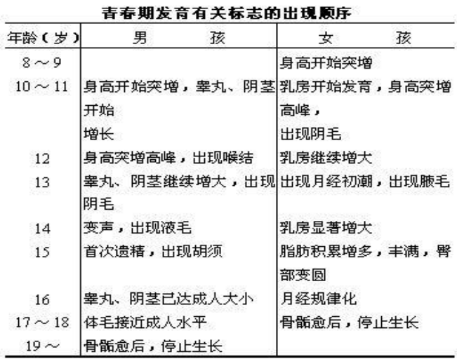
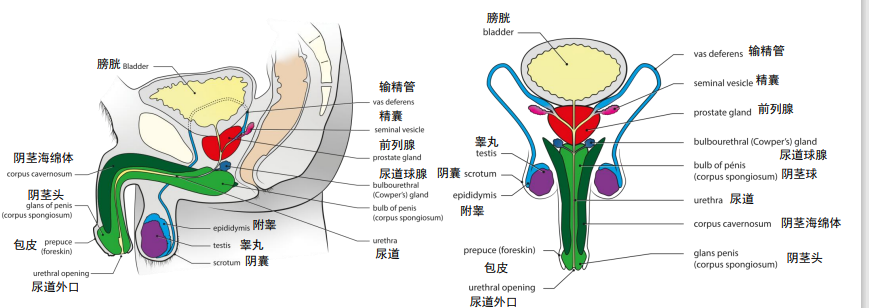
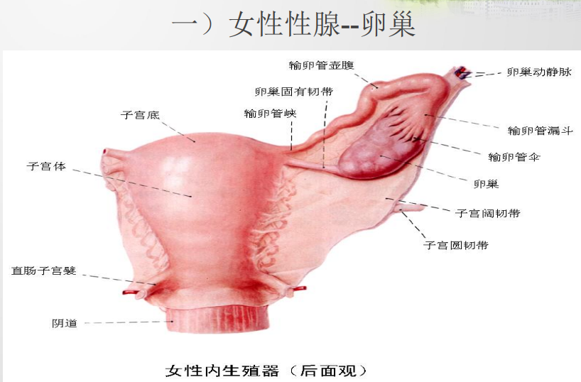
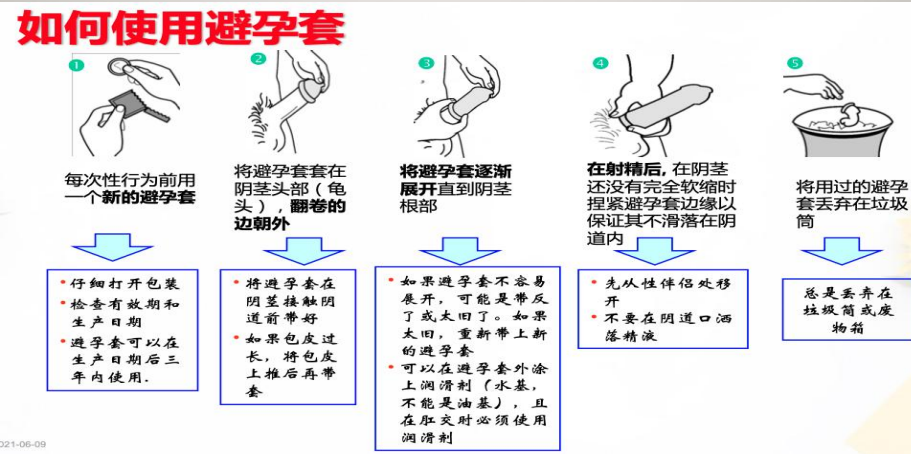
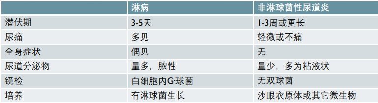

# 性医学笔记

> 来源：WH性医学笔记（嫌PPT打印太多的的可以用）.docx。以下按原稿转换为网页阅读版，保留正文、表格、插图和原稿用语；历史分类及诊疗表述未作医学事实校订。原 Word 文件可通过页面顶部“下载原笔记”获取。

## 目录

> 第一章 性医学的发展史…………………………………… 2
>
> 第二章 性的生理学
>
> 第一节 性发育生物学………………………………2
>
> 第二节 男性生殖器官结构与功能…………………3
>
> 第三节 女性生殖器官结构与功能…………………5
>
> 第四节 性激素……………………………………… 5
>
> 第三章 性的心理学
>
> 第一节 性心理健康…………………………………5
>
> 第二节 恋爱与婚姻…………………………………7
>
> 第三节 性取向与性身份障碍………………………8
>
> 第四章 性行为
>
> 第一节 生命周期各阶段的性………………………9
>
> 第二节 性行为………………………………………10
>
> 第五章 男性常见性疾病
>
> 第一节 青春发育异常………………………………12
>
> 第二节 性征异常……………………………………14
>
> 第三节 男性性腺功能减退症………………………14
>
> 第四节 勃起功能障碍ED……………………………16
>
> 第五节 早泄PE………………………………………18
>
> 第六节 精索静脉曲张………………………………19
>
> 第七节 睾丸肿瘤……………………………………20
>
> 第八节 前列腺保健…………………………………21
>
> 第六章 女性常见性疾病
>
> 第一节 卵巢早衰POF………………………………21
>
> 第二节 卵巢肿瘤……………………………………22
>
> 第三节 女性性功能障碍……………………………24
>
> 第四节 不孕不育……………………………………25
>
> 第五节 避孕与人工终止妊娠………………………28
>
> 第七章 性传播疾病STD……………………………………33

**考点：PGC特化**

## 第一章 性医学的发展史

#### 性学的发展的五个阶段

1)  性学的创始期与心理学阶段：1884-1992

    1)  克拉夫特-埃宾：**《性心理病》**是现代性医学的奠基之作

    2)  弗洛伊德：幼儿性欲理论性本能学说和人格结构论，创立了精神分析疗法

    3)  赫希菲尔德：《同性恋》认为同性恋是一种自然差异

    4)  摩尔：首次阐述了幼儿性欲的概念，《相反的性感受（同性性行为）》、《性欲调查》、《儿童的性生活》

    5)  布洛赫：性学*sexology*之父

2)  性学的发展与行为学阶段：1992-1959

    1)  华生：世界上最早勇敢地对性反应过程进行实验室研究的科学家

    2)  金西：《人类男性性行为》和《人类女性性行为》被誉为现代性学的第一座里程碑

3)  性学的成熟期与治疗学阶段：1959-1975

马斯特斯－约翰逊夫妻：《人类性反应》把性反应划分为兴奋期、平台期、高潮期和消退期，总结出性感集中训练等一整套行为治疗ED/PE的方法，创立了人类性治疗的新纪元

4)  性学从狭义向广义的发展：1975-1995

5)  性医学进入药物治疗时代：1996-至今

1988年3月西地那非（伟哥）在美国公开上市

## 第二章 性的生理学

### 第一节 性发育生物学

#### 性的生物进化

1)  无性繁殖：裂体繁殖、出芽繁殖、孢子繁殖

2)  有性繁殖：体内受精、体外受精

3)  性与生殖分离：克隆、助孕、避孕

2.  **性别决定*sex determination***：决定未分化性腺向睾丸方向发育还是向卵巢方向发育的过程

1)  SRY(*sex determination region of Y*) 染色体短臂上的Yp11.3/TDF（睾丸决定因子）决定胎儿睾丸的形成与分化，7-8周出现

2)  Xp21．3 的DAX1基因，决定卵巢的发育，10周由100万个停滞于第1次减数分裂前期的初级卵母细胞组成

3)  一个个体无论有几条X染色体，Y染色体决定男性表型，缺少特定的男性影响因素作用即具有向女性生殖系统发育的自然趋势

4)  原始生殖细胞（PGC）的迁移是生殖系统发生的一个重要阶段，只有正确迁移的PGC才能够继续存活并开始分化，没有到位的将会凋亡，否则可能会引起生殖细胞肿瘤

3.  **性别分化*sex differentiation***：在性腺所产生的激素作用下，体细胞分化发育成不同性别的生殖管道、外生殖器以及形成第二性征的过程

| 类别 | 分项 | 男性 | 女性 |
| --- | --- | --- | --- |
| 内生殖器 | 生殖腺 | 睾丸（最先发育） | 卵巢 |
|  | 生殖管道 | 附睾、输精管、射精管、尿道 | 输卵管、子宫、阴道 |
|  | 附属腺 | 精囊、前列腺、尿道球腺 | 前庭大腺 |
| 外生殖器 |  | 阴囊、阴茎 | 外阴 |
| 生殖器官的主要功能：繁衍后代，形成并保持第二性征 |  |  |  |

1)  生殖管道的发生

    1)  未分化时均为Muller管和Wolff管

    2)  男性：Muller管退化，Wolff管发育成为附睾管、输精管、 精囊、前列腺等

    3)  女性：Muller管持续发育呈输卵管、子宫、阴道、处女膜，一部分Wolff管退化，残留的与其他组织形成卵巢旁体等退化结构

2)  外生殖器的发生：9周之前均为生殖结节，男性外生殖器在雄激素作用下出现，无雄激素则自然向女性方向发育

3)  第二性征的形成

    1)  青春期(Adolescence, puberty）：由儿童发育到成人的过渡时期，从体格生长突增开始，到骨骼完全融合、躯体停止生长、性发育成熟而结束

    2)  青春期的启动机制：中枢神经系统对性发育的抑制作用下降；下丘脑-垂体-性腺轴对性激素的负反馈作用敏感性下降；下丘脑、腺垂体、性腺、甲状腺、胰岛、松果腺等内分泌系统的影响

    

    1)  女性第二性征发育：

        1.  女孩的青春期通常开始于9～11岁，较男孩要早两年

        2.  卵巢分泌的雌性激素逐渐增多，使得乳房及子宫发育，脂肪的分布形成女性体型

        3.  女性也分泌雄激素，使阴毛及腋毛生长、阴蒂及大阴唇增长

        4.  11～13岁，丘脑下部开始周期性地释放性激素，于是女孩出现了月经

        5.  雄激素影响男女两性的性欲及生殖器的敏感度

    2)  男性第二性征发育：

        1.  12岁左右，男孩的睾丸开始增大

        2.  约一年之后，睾丸酮的产生开始逐渐增多，使得阴茎增大、阴毛生长、前列腺增大、声音变粗，形成男性的肌肉和骨骼

        3.  通常在14左右岁时，就像女性月经初潮一样，男孩开始射出带有活精子的精液

        4.  雄激素影响男女两性的性欲及生殖器的敏感度

### 第二节 男性生殖器官结构与功能

#### 睾丸【生殖腺】

1)  位置：位于阴囊内，左右各一

2)  大小：青春期前发育较慢, 近性成熟期迅速发育，老龄后萎缩变小，中国人正常睾丸大小平均约3.5x2.5x2cm

3)  功能：产生男性生殖细胞(精子)和分泌雄激素，雄激素与第二性征、性功能、前列腺、生育功能的发生和维持，男性情绪、行为和人类创造进取心有关

4)  被膜结构：睾丸被膜表面光滑，称睾丸包膜，分为三层

    1)  睾丸鞘膜，来自鞘状突，分为壁层和脏层，两层间的鞘膜腔有浆液起到润滑作用，适合睾丸在阴囊内活动

    2)  睾丸白膜，位于脏层鞘膜之下，为一层坚厚的纤维膜，紧密包绕睾丸实质；白膜后上方即睾丸门，特别增厚，称为睾丸纵隔，由此分出许多纤维组织伸入睾丸实质

    3)  血管膜，紧贴白膜深面，是睾丸实质血供的主要来源

5)  实质结构

    1)  睾丸纵隔凸入睾丸内形成睾丸小隔，产生100～200个睾丸小叶，每个睾丸小叶内含有2～4条生精小管，精子在生精小管内产生

    2)  生精小管汇合成直细精管，进入睾丸纵隔后交织成睾丸网，从睾丸网发出12～15条睾丸输出小管，出睾丸后缘上部进入附睾

    3)  间质细胞leydig cell位于生精小管之间的结缔组织内，接受垂体性激素的调控并合成和分泌雄激素和睾酮，是维持男性性功能的重要细胞

#### 附睾【生殖管道】

1)  结构：睾丸输出小管进入附睾后，弯曲盘绕形成膨大的附睾头，末端汇合成一条附睾管，附睾管迁曲盘回而形成附睾体和尾，附睾尾向上弯曲移行为输精管

2)  功能：储存精子；分泌附睾液供给精子营养，促进精子成熟；运输精子

#### 输精管【生殖管道】

1)  结构：是附睾管的直接延续，长约30-35cm，与精囊的排泄管汇合成射精管，分为睾丸部、精索部、腹股沟管部和盆部

2)  功能：精子的运输；吸收与分泌功能

#### 射精管【生殖管道】

1)  结构：射精管由输精管末端与精囊排泄管汇合而成，向前下方斜穿前列腺实质，开口于尿道前列腺部

2)  功能：有助于精液射出

#### 尿道【生殖管道】

1)  起止：起自膀胱的尿道内口,止于阴茎头的尿道外口，成人长约16-22cm，管径约5-7mm

2)  结构：尿道可分前列腺部、膜部和海绵体部。

3)  功能：排尿和射精

#### 精囊腺【附属腺】

1)  结构：类似一对长椭圆形囊状器官，主要有迂曲的小管构成；上端游离，膨大处为精囊腺底，下端细支为排泄管，并与输精管末端汇合形成射精管

2)  功能：分泌弱碱性的黄色粘稠液体，构成精液的主要成分之一；含有前列腺素和丰富的果糖，营养和稀释精子

#### 前列腺【附属腺】

1)  结构：男性生殖器最大的附属腺，由腺体组织和肌性组织组成

2)  功能：分泌前列腺液；射精的通道；控制排尿；内分泌功能

#### 尿道球腺【附属腺】

1)  结构：一对似豌豆大小的男性附属腺，呈棕黄色，直径约1cm，位于会阴深隙内的尿道括约肌或会阴深横肌束间，位于尿道球部上方的后外侧；该腺的排泄管很细，长3～4cm，它穿经尿生殖膈下筋膜，在其下方约2.5cm开口于尿道球。

2)  功能：分泌尿道球腺液，是精液的组成成分之一（其中约含0.1～0.2ml 尿道球腺液）；射精时首先排出的是尿道球腺液和尿道旁腺液

3)  尿道球腺液的作用：供给精子营养、利于精子活动、润滑尿道

9.  **阴囊*scrotum*【外生殖器】**

1)  位置：位于耻骨联合下方，阴茎根部的后下方，两侧大腿部之间

2)  结构：阴囊共七层，手术时视为三层

    1)  最外：皮肤、肉膜

    2)  中间：精索外筋膜、提睾肌、精索内筋膜、脂肪组织

    3)  最内：睾丸鞘膜

3)  功能：内藏睾丸、附睾和精索下部；阴囊一般情况下处于收缩状态，表面有皱襞，随温度变化其形态有改变，冷则皱缩，热则弛缓伸长，借此能调节阴囊内温度，以利于精子生长和发育

10. **阴茎*penis*【外生殖器】**

1)  结构：阴茎分为头、体、根三部分

2)  解剖层次：阴茎的层次由浅至深依次为皮肤、阴茎浅筋膜（*Colles*筋 膜）、阴茎深筋膜（*Buck*筋膜）、白膜、阴茎和尿道海绵体以及尿道

3)  功能：泌尿和生殖系统的排泄管，也是主要的性器官

### 第三节 女性生殖器官结构与功能

#### 卵巢

1)  表面上皮：单层扁平或单层立方上皮

2)  白膜：薄层结缔组织

3)  实质：

    1)  皮质：不同发育阶段的卵泡、黄体、白体

    2)  髓质：门细胞产生雄激素

### 第四节 性激素

#### 雄激素

1)  睾丸产生

2)  作用：与第二性征、性功能、前列腺、生育功能的发生和维持，男性情绪、行为和人类创造进取心有关

#### 睾酮

1)  受下丘脑垂体-性腺轴调控，睾丸间质细胞产生

2)  正常人体的总睾酮8-30 nmol/L，生物活性睾酮2.5-4.2nmol/L

3)  存在形式：游离睾酮、与白蛋白结合的睾酮（转运形式）、与性激素结合的睾酮、结合的睾酮 (SHBG)、

4)  作用：促进毛发生长和皮脂腺分泌，增加肌肉强度和肌肉量，加速骨骼生长和骨骺闭合，在肝脏合成血清蛋白，刺激骨髓干细胞造血，刺激肾脏红细胞生成素的生成，产生性欲、进取、主动情绪，与阴茎发育、精子生成、勃起和射精有关

#### 卵巢的内分泌功能

1)  次级卵泡

    1)  内膜细胞：雄激素

    2)  颗粒细胞：将雄激素转变为雌激素

2)  月经黄体

    1)  膜黄体细胞：与粒黄体细胞协同分泌雌激素

    2)  粒黄体细胞：孕激素

3)  妊娠黄体：孕激素、雌激素、松弛素

4)  门细胞：雄激素

## 第三章 性的心理学

### 第一节 性心理健康

#### 性心理的概念

指在性生理的基础上，与性征、性欲、性行为有关的心理状态与心理过程，也包括了与异性交往和婚恋等心理状态。性生理是性心理发展的生物学基础，性生理发育的障碍或缺陷，会使性心理的发展出现偏差。

#### 性心理的研究内容

1)  心理活动对性行为的影响以及性活动中的心理反应

2)  两性的心理差异，男女性反应周期

3)  性的社会化及社会问题

4)  不同年龄阶段的性意识差异

5)  特殊群体的性心理

6)  性功能障碍、性心理和性行为障碍的成因及防治

#### 性心理学的研究方法

观察法、调查法、实验法

#### 性心理学发展阶段

1)  第一阶段：弗洛伊德，性心理学研究阶段，《歇斯底里研究》、《性欲三论》、《自我与本我》、《抑制、症状与焦虑》

2)  第二阶段：金赛，性行为描述研究阶段

3)  第三阶段：美国妇产科专家玛斯特斯和心理学家约翰逊夫妇，性反应的实验研究阶段

#### 弗洛伊德：驱动理论（生本能和四本能）

1)  基本观点：性本能是人格发展的基本动力，根据个体性力满足的方式和部位不同把人格发展划分为五个阶段，在每一阶段都要求有最佳程度的满足，否则产生心理疾病

2)  口欲期：0-1，5岁

    1)  包括吸吮、吞咽、咀嚼、撕咬

    2)  利于建立安全感和信任感，形成自信、乐观、开放的性格

    3)  口腔攻击型人格：缺乏安全感、悲观、敏感多疑、苛求；从事那些象征着咬人的活动，如讽刺挖苦他人、指责评价他人、口头攻击他人等

    4)  口腔依赖型人格：过于依赖，以自我为中心，不现实，善妒；从事大量的口唇活动，诸如沉溺于吃、 喝、抽烟、接吻等，甚至于含手指头、嚼口香糖等

3)  肛欲期：1.5-3岁

    1)  自主控制大小便

    2)  肛门排泄型人格：邋遢、浪费、 无条理、放肆、凶暴等，生活凌乱，办事马虎，缺乏责任感，铺张浪费

    3)  肛门滞留型人格：过度控制的行为习惯，如洁癖、墨守成规、固执、强迫症等；吝啬、囤积旧物；反向形成喜欢挑衅、作对、攻击

4)  性器期：3-6岁

    1)  特点：抚摸和显露自己的生殖器，关注性别差异，恋父情结、恋母情结，阉割焦虑和阴经嫉羡

    2)  俄狄浦斯情结（恋母情结），伊赖克特情结（恋父情结）

        1.  3-6岁出现第一恋母情结

        2.  进入青春期后出现了第二恋母情结，第二恋母情结的对象不再是自己的亲生父母而是父母的替代者，即家庭之外的两位长者

        3.  随着年龄的增长，恋母情结的对象渐渐年轻化，终于被同龄人所取代，此时，相似作用表现为与同性的同龄人形成友谊，互补作用表现为与同龄异性相爱，真正意义上的友情和爱情产生了，这就是第三恋母情结

        4.  第三恋母情结有两种特殊形式，分别称为 “安提戈涅情结”（ 兄妹乱伦的主题）和“该隐情结”（ 同胞相残的主题）

5)  潜伏期：6-12岁

    1)  注意力从自己的身体和对父母的感情转向外部的环境，转向学习和游戏，更多地与同性同伴相处，培养兴趣，建立习惯

6)  生殖期：12-18岁

    1)  性需求朝向年龄接近的异性，并希望与其建立两性关系，

    2)  用很多种社会可接受的方法处理性能量，如交朋友、从事艺术活动或运动、工作

    3)  性心理的发展走向成熟，人格也趋向成熟

#### 性心理健康

1)  概念：通过丰富和完善人格、人际交往和爱情方式，达到性行为在肉体、感情、理智和社会诸方面的圆满和协调

2)  表现：

    1)  健康的性意识：正确的性别认同，正确的性对象，正确的性行为意识

    2)  健康的性情感：正常的异性吸引 (包括异性的外形美与内在美、仪表、接近、互补等)，从友情到爱情的转化，情爱与性爱的结合等

    3)  健康的性观念：符合科学，合乎自然，合乎道德规范

    4)  健康的性需求：这是指受健康的性观念、性情感与性意识约束的性需求

#### 男女性心理的对比

1)  男性性感受是与生俱来的，女性性感受是后天习得的

2)  男性对视觉的性刺激更敏感，女性则对听觉的刺激更敏感

3)  男性注重性器官的直接刺激，女性更注重情感的需求

### 第二节 恋爱与婚姻

#### 恋爱

1)  目的：找到终身伴侣，即婚姻，结合人生目标、价值观、生活态度

2)  前提：健康的性心理，首先自己要是一个成熟的有性别的人，其次对异性的心理特点和过程要有所认识了 解，第三是掌握与异性交往的原则、规范和方法

3)  基础：建立一个广泛异性交往群体是择偶的基础

4)  内容：全方位了解对方，包括对方价值观、性格、能力、情趣等，以及互相接受的程度

5)  方法：全面了解、保持理性、慎重同居、发展观点、尊重对方

#### 爱情的基本三角形原理

1)  亲密成分(Intimacy)

    1)  指在爱情关系中能促进亲近、连属、结合等体验的情感

    2)  内容：改善所爱的人的福利的愿望；与所爱的人在一起体验到快乐；对所爱的人高度的关注；在需要帮助时能指望所爱的人；互相理解；分享一个人的自我和一个人的所有；接受来自所爱的人的情感方面的支持；对所爱的人提供情感方面的支持；能与所爱的人进行亲密的沟通交流；重视对方在自己生活中的价值

2)  激情成分(Passion)/情欲成分

    1)  指能引起浪漫恋爱、体态吸引、性完美的驱动力，以及爱情关系中的其它有关现象

    2)  在爱情关系中，性的需要是引起这种激情体验的主导形式

3)  决定成分／忠守成分(Decision/commitment)/ 承诺成分

    1)  短期指一个人做出了爱另外一个人的决定；长期指那些能维持爱情关系的承诺或担保、投入、忠心、义务感或责任心

    2)  现实中的三角形与理想中的三角形之间的重合情况如何，自己的三角形和对方的三角形之间的匹配情况如何，自己知觉到的三角形与对方知觉到的三角形之间相符合的情况如何，都会影响到对关系的满意与不满意

#### 恋爱常见问题及对策

1)  喜欢不会表达：可用暗示、请别人转达、写信、当面明确表达等方法

2)  我喜欢对方对方不喜欢我：应该给予理解，并给对方时间考虑，与此同时自己可以尝试别的选择，调整自己的择偶标准

3)  如何知道女生喜欢什么：只要认真地为自己喜欢的女生做好力能及的事，即足以感动女生了

4)  如何让男生了解自己的心意：男生在非常自信时才会这样尽情的表现，会试探、会敏感、会拘谨。此时，需要女生理解、恰当的鼓励，使他建立自信，鼓起勇气

5)  如何面对恋人另有所爱：两个人都需要有心理准备，做到感情不受害，同时不要做出极端的举动，因为只要双方没有结婚，比较和选择就还在继续

6)  如何面对男友的性要求：男生确实要尊重女生，而女生要避免非愿性交的发生

7)  如何理解门当户对：文化背景的一致，由此形成的价值观、人生观和世界观一致，才是门当户对的真正意义所在

#### 婚姻的本质

1)  概念：婚姻是人类社会两性结合的形式，它是由两个不同性别的人，以爱情为基础组 成的，包涵规范性行为及繁衍后代为目的的人类社会生活共同体，是家庭的基础

2)  意义：婚姻的内涵最基本的是规范两性性行为，进而使生殖避免性传播疾病和保障后代的健康

#### 婚姻的阶段

1)  过程：蜜月-角色转换 -哺育子女-赡养老人-空巢 -衰老

2)  关键步骤：找对人，乐于付出，机智调试，耐心等待

#### 婚姻常见问题

1)  在校大学生结婚的利弊

    1)  利: 可以随时解决性冲动问题，解除了性压抑；理性的性行为也可以避免意外妊娠；爱情的力量可以督促对方不断进取，互相帮助高质量的完成大学学业，建筑社会生活的良好起点；可以专心于对未来更有益的事情。

    2)  弊:失去与周围随时交流、开阔眼界的机会；缺少角色转变和解决婚姻难题的锻炼；大学期间很多人的人生观和价值观没有固定形成，没有经历复杂社会生活的历练。

2)  女性的最佳结婚年龄

24-28岁是最佳优生年龄， 35岁以上是高危孕龄。从生育角度考虑婚姻，那一定要在35 岁以前，为怀孕留有余地不要晚于32岁。

### 第三节 性取向与性身份障碍

#### 人的性别

| 项目 | 原稿左列 | 原稿右列 |
| --- | --- | --- |
| 染色体性别 | XY | XX |
| 性腺性别 | 睾丸 | 卵巢 |
| 内外生殖器性别 | 输精管、附睾、前列腺、阴茎、阴囊 | 输卵管、子宫、阴道、阴蒂、大小阴唇 |
| 性激素性别 | 雄激素 | 雌激素 |
| 社会性别 | 男性 | 女性 |
| 心理性别 | 个人的性格、行为、性欲等 |  |

影响因素：

1)  性染色体（根本因素）决定性腺性别，性腺决定激素性别、生殖器性别

2)  生殖器的发育也与常染色体有关，受遗传因素、激素水平影响

3)  心理性别、社会性别也与社会环境、教育等因素有关

#### 性取向

是指一个人对特定性别的持久性情感、浪漫、与性吸引力。可分为同性恋、双性恋、异性恋

#### 同性恋问题

1)  真性同性恋/素质性同性恋：性活动不仅仅是感情之间的相互吸引和依恋，还包括肉体上的性行为

2)  假性同性恋/境遇同性恋：通常指由于长期生活在与异性隔离的生活环境，如军营、海轮、监狱等地方，由于没有合适的异性伙伴，而把同性作为满足自己性欲对象的同性恋者；这类同性恋者一旦生活情境改变，就会改变自己的情欲对象，与异性相恋

3)  精神同性恋/同性爱慕：只表现在个人精神上，把对同性的欲望存于心底或幻想、梦想之中

#### 同性恋治疗方法（有意愿者）

1)  支持性心理连发：建立同性恋者治疗意愿

2)  认知疗法：改变适应不良性认知，增强对心理变态的认识，帮助建立和提高治疗意愿

3)  精神分析疗法：揭示同性恋者的深层情结

4)  行为疗法：改变性爱对象

5)  社交技巧训练：重塑角色行为

#### 易性症

1)  概念：指患者对自身性别的认定与解剖生理上的性别特征呈持续厌恶的态度，并有改变本身性别的解剖生理特征以达到转换性别的强烈愿望（如使用手术或异性激素）

2)  治疗流程：精神科诊断与评估—内分泌科激素治疗—整形科手术治疗（隆胸术、子宮切除手术和卵巢切除术、阴道成形术）

3)  当前存在问题：行业标准尚未规范化、团队构建有待完善、治疗细节和随访不规范、相关法律法规不健全

## 第四章 性行为

### 第一节 生命周期各阶段的性

#### 幼儿期

1)  生理特点

    1)  3-3.5岁，通向阴茎和阴蒂的感觉神经的髓鞘完全形成，使得这些部位有了更为分立的、更为强烈的性感体验

    2)  此期不论男童女童，雄激素的产生均有轻度的增加，使男女两性的性欲增高，并使阴茎和阴蒂对触觉刺激敏感化

2)  性意识的蕴育

    1)  幼儿期是儿童心理发展的飞跃时期，也是性心理发育的重要时期

    2)  此阶段是性意识的蕴育阶段，其性愉快体验从无意向有意转化，逐渐认识到性器官的差异，识别性身份，并开始意识到性角色

    3)  弗洛伊德将此期称之为“最重要的时期”，“因为它打下往后一切性的发展的基础和方向”

3)  幼儿期性心理的主要特点

    1)  幼儿性别身份和性别角色的发展，自发性与好奇性，幼儿自慰，阴茎崇拜，对人的出生、男女身体的不同好奇

    2)  恋父情结与恋母情结：俄狄浦斯情结（恋母情结），伊赖克特情结（恋父情结）

        1.  3-6岁出现第一恋母情结

        2.  进入青春期后出现了第二恋母情结，第二恋母情结的对象不再是自己的亲生父母而是父母的替代者，即家庭之外的两位长者

        3.  随着年龄的增长，恋母情结的对象渐渐年轻化，终于被同龄人所取代，此时，相似作用表现为与同性的同龄人形成友谊，互补作用表现为与同龄异性相爱，真正意义上的友情和爱情产生了，这就是第三恋母情结

        4.  第三恋母情结有两种特殊形式，分别称为 “安提戈涅情结”（ 兄妹乱伦的主题）和“该隐情结”（ 同胞相残的主题）

#### 童年期

1)  童年期的性生理

    1)  幼儿期（第一生长高峰）与青春期（第二生长高峰）之间的阶段称为童年期，即以生理年龄和生理发育标志为划分标准，而不是以实际年龄

    2)  儿童期的生理发育与婴幼儿期相比，相对缓慢而平稳，生殖器与性腺等的发育处于相对停滞的阶段

    3)  儿童的性活动仍然不断地稳步发展

2)  童年期的性心理：探索与学习阶段，儿童期是人类性生理成熟和性心理成熟这一性发展全过程的开始，也是这一过程正常发展的关键

    1)  性别身份和性别角色得到认同

    2)  女孩子的性欲受到压抑，“性的潜伏期”，表现为对异性的冷淡和回避，不齿于谈性，害羞

    3)  男孩子相比之下，性活动仍在继续，会延续幼儿时期的手淫行为（玩弄阴茎），对性的好奇和探索加大，性快感体验由自身指向成年异性

    4)  在这个阶段，男生开始对第二性征明显的女性产生好感

    5)  性的无意识期：没有完整的性别感念，男女之间基本以“中性” 的状态友好相处

#### 青春期

1)  青春期的性心理：躁动的爆发

    1)  青春期是童年走向成年的过渡，主要标志是性发育和性成熟，其时要经历躯体和心理上的急剧变化，是青少年社会化的重要时期

    2)  随着性腺活动的变化，青少年发生正常性心理行为，如强烈的性感受和性幻想，男孩阴茎自动勃起的次数增加，女孩阴道分泌液增加，自慰行为的频率上升，并开始对异性产生兴趣，包括扩大性活动的范围，如对异性拥抱、接吻、爱抚，甚至发生性交关系等

    3)  男女生可能出现第二性征带来的困惑

        1.  女生：乳房发育，阴毛、腋毛生长，月经来潮，身体探秘的开始，性幻想

        2.  男生：初次射精，手淫，阴茎的大小，多渠道了解性知识

    4)  儿童与青春期性意识的发展过程

        1.  性的无意识期（童年期） →友好又亲密

        2.  异性疏远期（第二性征出现后的一两年内）→表面疏远，却隐藏着对异性的好奇

        3.  异性向往期（青春期中期）→彼此愿意，互相吸引

        4.  恋爱期（青春期向成年期的过渡阶段）→互相爱慕，进入交往

#### 成年期

1)  成年期的性生理

    1)  女性敏感区：G点，阴蒂及其周围，小阴唇的内表面和阴道的边缘，乳房、乳头及其周围，肛门附近，大腿内侧，耳背，脖子，背部， 手肘侧等

    2)  男性敏感区：阴茎头，阴茎，阴囊、大腿根部内侧，乳头，口唇，手指

    3)  性爱过程的四个阶段

        1.  兴奋期是指性欲被唤起，身体开始呈现性紧张的阶段，又称唤起期

        2.  持续期指性兴奋不断积聚、性紧张持续稳定在较高水平阶段，又称平台期、高涨期

        3.  高潮期指在性持续期的基础上迅速发生身心极度快感阶段，是性反应周期中最关键最短暂阶段

        4.  消散期指性高潮后性紧张逐步松弛并恢复到性唤起前状态的阶段

2)  成年期的性心理

    1)  女性性的初体验：建立在情感的基础上，由爱生性；正面感觉包括义务感、归属感，负面感觉包括恐惧感、厌恶感、受辱感、丧失童贞，成为“大人”，成为和以前不同的一种人，这种认知改变源于心理而非生理

    2)  男性性的初体验： 可以建立在情感上，也可以有性无爱；正面感觉包括使命感、成就感、征服感，负面感觉包括过度担心、忐忑、自卑感 觉得轻松和骄傲，终于“是个男人”了，不过也感觉到缺乏技巧和知识。

#### 更年期，老年期

1)  更年期与老年期的性生理

    1)  男性：生理变化为睾丸功能减退，性激素分泌减少，性功能逐渐减弱

    2)  女性：绝经，卵巢萎缩和性机能的衰退，外阴及阴道分泌物减少， 变得干燥，弹性也变差，性生活时感到疼痛

2)  更年期与老年期的性心理

    1)  性淡漠 、性厌烦、错误的性观念

    2)  老人性生活可持续到70岁

    3)  禁欲保精并不能延年益寿

### 第二节 性行为

#### 性行为的定义

为满足性欲和获得性快感而出现的活动，狭义性行为指具有生殖意义的性交，广义的性行为指接吻、拥抱、口交、自慰等与性关联的行为，甚至性梦和梦遗也可包含在性行为的范畴之内

#### 性行为特征和功能

1)  人类的本能行为之一

2)  最自然的生理需要

3)  种族延续的基本纽带

4)  具有享乐功能

5)  人类生活乐趣的重要形式

#### 人类性行为的特点

1)  持续性（非生育目的）

2)  隐密性（害羞性）

3)  排他性（心理上的独占性）

4)  社会性（伦理与法制性）

5)  圣洁性（对意义的追求）

#### 性禁锢的历史与现状

1)  西方：

    1)  性禁锢思想最早萌芽于古希腊

    2)  古代罗马人的性开放与性自由

    3)  基督教的禁欲主义在欧洲大行其道

    4)  马丁·路德发起的宗教改革运动

    5)  文艺复兴时期主张光复人性

    6)  19世纪的维多利亚时代，禁欲之风又席卷欧美

2)  我国：

    1)  先秦时代，人们的性行为和性观念从自由逐渐变得规范

    2)  儒家思想对性的规范和限制也不断加强

    3)  “程、朱礼学”将中国的性禁锢逐渐推向极致

    4)  明清，禁欲主义从思潮变成了政治和法律制度，清朝性禁锢达到了中国历史的顶峰

    5)  戊戍变法中，提倡介绍性知识，打破性禁锢、性神秘的性文化运动

    6)  民主革命时期，两性平等进入了主流社会活动

    7)  新中国成立之后，恋爱自由，婚姻自主蔚然成风

    8)  改革开放，随着经济的迅速发展，性观念也越来越开放

3)  性禁锢的影响

    1)  通过畸形的方式进行性宣泄：自阉、自笞、通奸、私通、鸡奸、乱伦

    2)  性忌讳和神秘化，造成人们的性无知

    3)  不良性习惯、性功能障碍、心身疾病

#### 性放纵的历史与现状

1)  西方：

    1)  人类在原始时期过着群婚杂交的生活，产生了性崇拜和生殖崇拜

    2)  人类社会出现私有制之后，性行为便成为财富和权利享受的象征，出现了真正意义上的性放纵从公元前500年到公元前300年，古希腊人对性生活毫不忌讳，行为放纵

    3)  古罗马人粗野、放纵，他们既放纵性欲，也放纵其他方面的一切欲望

    4)  随着12世纪欧洲经济的发展和城市的兴起，人们的性观念和性行为也开始发生巨大的变化

    5)  从14到16世纪，文艺复兴运动使人性得到解放，性观念也变得开放了

    6)  20世纪60-70年代性解放运动被推至巅峰，形成了一场性革命

2)  我国：

    1)  “民知其母而不知其父”

    2)  夏商奴隶制社会时中国上流社会的通奸、乱伦风气盛行

    3)  汉朝时期中国的性观念相对比较开放

    4)  唐朝是中国性最开放的朝代之一

    5)  宋朝之后封建礼教日渐严酷，国人的性观念十分保守

    6)  明朝万历年间（1573～1620），边界和平，工商业发达，又滋长了浮华世风

    7)  改革开放以后的中国，随着经济的迅速发展，性观念也越来越开放

3)  性放纵的影响

    1)  影响家庭稳定型、高离婚率、高同居率

    2)  导致性传播疾病：梅毒、淋病，生殖器疱疹，艾滋病

#### 自慰与手淫

1)  手淫是一种性成熟男女中常见的自慰性性行为，表现为用手作用于生殖器官，以自我获得的形式引起类似性交时产生的快感或性兴奋

2)  手淫主要发生在青少年时期，在已婚成人或老年人群中也有发现

3)  手淫本身对人体没有伤害，只是过频、过快导致了其它方面的疾病才给身体带来影响，应适当把握频率

#### 性治疗

1)  基本程序：获得认可，消除恐惧焦虑—给予性有关信息—提出针对性意见

2)  常用治疗方法：性知识教育、行为认知疗法、系统脱敏法、催眠疗法、精神分析法、性感集中训练法、药物治疗

    1)  精神分析法理论基础：在成长过程中特别成年后无可选择或没有适宜的性对象；对于必须放弃的童年早期性对象至今仍在潜意识中迷恋

    2)  催眠疗法：分析原因—解除忧虑—疏导暗示—咨询服务—试行阶段

    3)  性感集中训练法：性认知的一致与焦虑的松弛--非性器宫的肉体及情感交流--性器宫的抚摸与手淫技术的应用--治疗性性交活动

    4)  药物治疗：万艾可、希爱力、激素替代疗法

## 第五章 男性常见疾病

### 第一节 青春发育异常

#### 性早熟

1)  定义：男孩9岁前出现明确的第二性征，女孩8岁前出现月经初潮

    1)  正常时，生物年龄与骨年龄一致。男孩在12-14岁时，女孩在11-13岁时开始青春发育

    2)  骨龄与青春发育相关最密切 n 性早熟时，骨龄＞生物年龄；青春发育延迟时，骨龄＜生物年龄

    3)  与营养、环境污染、视觉刺激等因素有关

2)  分类

    1)  真性性早熟：中枢感染、外伤、肿瘤，CAH 患者糖皮质激素治疗后，特发性

    2)  假性性早熟：服用含雄激素的药物或食物，分泌雄激素的肿瘤

3)  性早熟的治疗：病因治疗

    1)  治疗的目的：去除危及生命的鞍区肿瘤；使患儿与同龄男孩发育同步;防止骨骺早闭，以至影响最终成年身高

    2)  中枢性性早熟用长效LHRH类似物治疗效果最佳

    3)  周围性性早熟的治疗主要是去除病因

    4)  先天性肾上腺皮质增生症(CAH)所致的周围性性早熟主要用糖皮质激素

#### 青春发育延迟

1)  体质性：家族遗传，营养不良，系统性疾病的影响

2)  性腺功能减退症：原因众多，分原发性和继发性性腺功能减退症

#### 男性乳房发育

1)  临床表现

    1)  早期腺管上皮增生为主，晚期有管周结缔组织增生，并发生纤维化和透明样变

    2)  新生儿、青春发育期、老年是常见的三个时期

    3)  见于E2/T升高，肥胖，胸廓疾病，性腺功能减退症

2)  发生原因

    1)  发育所致：新生儿期、青春期、老年期

    2)  性腺功能减退所致：原发性(获得性或先天性)、外周组织芳香化酶活性增高、继发性

    3)  肿瘤所致：分泌固醇激素类肿瘤(睾丸、肾上腺)、hCG分泌瘤(睾丸或其他组织)、分泌雌激素的肿瘤

    4)  系统疾病所致：甲亢、肾衰竭、肝硬化

    5)  先天性异常所致：Klinefelter综合征、睾酮合成酶缺乏(可能晚发)、睾丸消失综合征(无睾症)、雄激素抵抗综合征、真两性畸形

    6)  其他原因所致：脊索损伤、HIV感染、胸廓外伤、心理应激、再喂食

    7)  药物所致：

> ①雌激素类：促性腺激素类、雄激素类(可芳香化)、抗雄激素类(CPA)、钙通道阻滞剂、ACE抑制剂类、洋地黄类、多巴胺拮抗剂（酚噻嗪、胃复安）、作用于中枢神经类药物
>
> ②引发乳房发育的个别药物：甲氰咪呱、螺内酯(安体舒通)、酮康唑
>
> ③引发乳房发育的杂类药物：氯米酚、抗高血压类、甲硝达唑、青霉胺

3)  治疗方案

    1)  治疗原发疾病如泌乳素瘤、肝病

    2)  停止使用致乳房增大的药物

    3)  肥胖者，应减轻体重

    4)  性腺功能低下者，补充雄激素

    5)  病程长、明显增大、药物治疗效果差者，可考虑手术治疗

#### 包皮过长/包茎

1)  定义：是指男性阴茎在自然状态下，阴茎头不能外露或仅有少部分外露

2)  分类

    1)  假性包皮过长：阴茎头自然状态下不能完全外露，勃起后可以完全外露

    2)  真性包皮过长：阴茎头自然状态下不能完全外露，勃起后仍然无法外露或只能部分外露

        1.  包茎：包皮口狭小，包皮不能上翻显露阴茎头

        2.  狭窄型：包皮上翻后仍遮盖部分阴茎头，勃起时暴露阴茎头后出现包皮嵌顿

        3.  全露型：勃起时容易上翻，完全暴露出阴茎头

3)  包皮过长的危害

    1)  影响阴茎发育

    2)  包皮垢引起炎症，狭窄甚至尿路感染

    3)  性交痛，包皮嵌顿

    4)  包皮积垢慢性刺激可诱发阴茎癌或配偶宫颈癌

    5)  与HIV感染相关

4)  日常护理与治疗

    1)  包皮过长患者需定期清洁，防止过多的包皮垢引发炎症

    2)  单纯包皮过长是否手术视情况而定，包皮环切术是目前治疗包皮过长的主要手段

    3)  嵌顿性包茎需要及时治疗，手法复位或急诊包皮环切术

    4)  对合并有严重粘连、反复感染者可以先用药缓解，然后再行手术

5)  手术适应症

    1)  包皮过长，包皮口较小者；包皮内或冠状沟积存包皮垢常伴发感染者

    2)  先天性包茎反复感染者；后天性包茎继发阴茎包皮炎，包皮口形成瘢痕性挛缩，常伴发尿道外口乃至全尿道狭窄，甚至诱发阴茎癌

    3)  嵌顿性包茎，经复位水肿消退，炎症控制后择期包皮环切

    4)  合并包皮良性肿瘤

6)  手术方式

    1)  传统包皮环切术

    2)  改良包皮环切术，如袖套式包皮环切术

    3)  器械辅助包皮环切术：套扎器类、缝合器类

#### 遗精/梦遗

1)  定义：指在没有性交或自慰情况下的射精；在入睡后做梦时遗精为梦遗，不在做梦时遗精称为无梦遗精，清醒状态下遗精则为滑精

2)  意义

    1)  是一种正常的生理现象，但如果出现频繁遗精，可能代表身体的异常

    2)  男性成熟的标志，研究显示首次遗精年龄不断提前，提示男性性早熟提前

3)  病理性遗精的表现

    1)  遗精次数频繁，一夜2-3次或每周2次以上，入夜即遗，或清醒时也会溢出精液

    2)  遗精后精神疲惫，腰膝酸软，耳鸣头晕，身体乏力等

4)  病理性遗精的病因

    1)  精神因素：过多的性刺激

    2)  体质因素：剧烈体力或脑力劳动后，身体疲惫，睡眠深沉，大脑皮质下中枢活动加强，也容易诱发遗精

    3)  局部病变：性器官或泌尿系统局部病变刺激，如包茎、包皮过长、尿道炎、前列腺炎、精囊炎、附睾炎等

5)  病理性遗精的诊断

    1)  多发于青壮年，常有精神、心理因素，或纵欲过劳史

    2)  遗精次数频繁，一夜2-3次或每周2次以上，入夜即遗，或清醒时也会溢出精液

    3)  遗精后精神疲惫，腰膝酸软，耳鸣头晕 ，身体乏力等

    4)  检查确定是否有生殖器及附属性腺的炎症

6)  日常护理与治疗

    1)  青年人应养成正确的性心理，学会转移注意力，避免性幻想

    2)  建立起有规律的生活作息习惯，养成早晨按时起床的习惯，不 要赖床，被子不要盖得太厚太暖，内裤不宜过紧

    3)  克服恐惧和内疚感

    4)  改变上述后仍频繁遗精者，需要就医查找各类可能诱发频繁遗精的泌尿生殖系统疾病和精神心理因素

### 第二章 性征异常

#### 先天性性征异常

1)  病因：母孕期感染，服抗雄激素类药物，环境污染（水源或大气）等导致的先天性或遗传性疾病

2)  临床表现：从轻度尿道下裂到完全女性化外阴外观

3)  常见遗传原因：雄激素合成酶、5α-还原酶缺乏，染色体数量、雄激素受体量和质异常，先天性肾上腺皮质增生（CAH）

#### 性别异常疾病的分类

1)  性染色体异常：e.g. 先天性卵巢发育不全Turner’s syndrome、 XO/XY性腺发育不全、超雌（47，XXX） 、曲细精管发育不全、真两性畸形（如46，XX/47，XXY等）

2)  性腺发育异常：e.g. XY单纯性腺发育不全、XX单纯性腺发育不全、睾丸退化、真两性畸形（染色体正常，性腺为真两性）

3)  性激素与功能异常：：e.g. 雄激素过多，雄激素缺乏，雄激素功能异常

#### 真两性畸形true hermphroditism

1)  概念：真两性畸形指体内同时存在卵巢和睾丸两种性腺组织，两种组织可分别在两侧或在同一个性腺内（卵睾）

2)  外生殖器表现型

    1)  外生殖器常具有不同程度的两性特点，大都有长度不等的阴茎体，约3/4被当作男孩抚养

    2)  男性型：都伴有不同程度的尿道下裂，多数有隐睾（易误诊为 单纯尿道下裂合并隐睾）

    3)  女性型：都伴有阴蒂肥大、大阴唇发育不良如阴囊皮肤

    4)  混合型：介于不同程度的男性、女性之间

3)  在5岁前的确诊率仅有20%

#### 治疗

1)  慎重选择社会性别

2)  根据社会性别整形

3)  轻度尿道下裂修补

4)  性激素补充治疗，主要补充雌激素

5)  心理治疗

### 第三节 男性性腺功能减退症

#### 概念

由于雄性激素缺乏、减少或其作用不能发挥所导致的性腺功能减退性疾病，结果导致青春发动延迟和（或）生育功能低下

#### 分类

1)  原发性：e.g. Klinefelter综合征、睾酮合成酶缺陷、5α-还原酶缺陷、睾丸LH抵抗、睾丸外伤、高泌乳素血症

2)  继发性：e.g. 低促性腺激素性性腺功能减退症、孤立性LH,FSH分泌不足、尿毒症、血色病

3)  混合性：e.g.老年、肝硬化、镰状细胞病、肥胖

#### 致病因素

环境污染，不良生活行为和营养，现代社会高度紧张和生活压力，杀虫剂，重金属污染、外源性雌激素污染

#### 特点

1)  雄激素分泌量减少或生精障碍

2)  可分原发性和继发性性腺功能减退症两大类

3)  骨折男性患者中，大约20-50%存在性腺功能减退症

4)  临床表现从仅有不育主诉而无任何体征到有明显的雄性化不全的体征

5)  青春期前、后发病者，临床体征不同

#### 临床表现

胎儿发育早期发生：患儿临床表现为生殖器发育难以辨认和男性假两性畸形

青春期前发生：患者主要表现为青春期发育迟缓和第二性征发育不良

成人期发生：主要表现为阳痿、不育和男性乳腺发育症。如果睾酮生成正常，仅单纯精子生成缺乏，患者主要表现为不育

#### 低促性腺激素型性功能减退症

1)  特发性低促性腺激素型性功能减退症IHH：下丘脑和垂体功能减退造成多种激素缺乏，目前尚未发现器质性病变

2)  下丘脑和垂体病变：如肿瘤、炎症、创伤、手术和放射治疗等原因导致下丘脑和垂体功能减退

3)  高泌乳素血症：见于泌乳素瘤、原发性甲减、某些药物（如雄激素、利血平、甲基多巴、西米替丁）、慢性肾衰、肝硬化

4)  单纯促性腺激素缺乏

①卡尔曼综合征Kallmann syndrome：家族性嗅神经－性发育不全综合征，为X隐性遗传或男性常染色体显性遗传，几乎全为男性患者，以嗅觉缺失和继发于丘脑下部GnRH缺失的性腺功能减退为特征，其他表现包括大阴茎和隐睾症、中线缺陷（如唇、腭裂、色盲）、单侧肾脏发育不良

②单纯性LH缺乏：患者有单一性的LH分泌缺失而FSH仍然正常

③单纯性FSH缺乏症：精子发育和生成障碍，成年后不育

5)  先天性肾上腺皮质发育不良：属于低促性腺激素性性功能减退症，为基因突变导致X-性连锁遗传肾上腺皮质发育不良；男婴出生后即有原发性肾上腺皮质功能减退，至儿童期可有一定程度改善，但无青春期发育

6)  功能性或体质性青春期延迟：男孩在14岁以后仍缺乏青春期发育，一般有父母或同胞性发育延迟的家族史

#### 高促性腺激素型性功能减退症

1)  克氏综合征

①发病率约1/600，男性不育中最常见的染色体异常

②常见核型为47,XXY，46,XY/47,XXY（10%），也可见48,XXXY; 49,XXXXY等

③典型体征：四肢修长，男性乳房女性化，小睾丸

④可能伴有语言障碍、认知障碍、行为或心理障碍等，常有性腺机能减退症状（体毛稀疏、性欲下降、阳痿、不育以及小睾丸等）

⑤发病机制：父源或者母源姐妹染色单体减数分裂（第一次或者第二次）时不分裂造成的

2)  强直性肌营养不良：大约80%肌营养不良的男性患者有原发性睾丸异常

3)  无睾症/睾丸消失综合征：双侧无睾，在胚胎形成的最初12周睾丸组织分化时睾丸是存在的，但在出生或孕后期被吸收；这些患者注射人类hCG后,血中睾酮不升高

4)  隐睾、特纳尔综合征等

8.  **迟发性性腺功能减退症*Late-onset of Hypogonadism,LOH***

1)  定义：一种与年龄增长相关的临床和生物化学综合征

2)  LOH特征：具有一定临床症状；血清睾酮水平降低；对机体多种器官、系统功能有不利影响；严重影响生活质量

3)  LOH发病机制

    1)  下丘脑-垂体-性腺轴缺陷：下丘脑的分泌储存受损，造成GnRH的分泌减少和紊乱；垂体对GnRH应答减少，致LH脉冲频率增加但不规则，振幅减小；睾酮昼夜节律消失

    2)  其他重要的方面：男性随着年龄的增长，性激素结合球蛋白（SHBG）水平每年增加1.3％。SHBG与睾酮的有力结合导致血浆生物活性睾酮水平明显下降；随年龄下降的血浆睾酮水平似乎是由遗传决定，雄激素受体基因中短CAG重复长度与迟发性性腺功能减退有关

4)  雄激素缺乏常见体征

    1)  特异性：性发育迟缓或不全，性欲减退，勃起功能障碍，不孕，小睾丸（＜5ml），毛发减少，乳腺不适、男子女性型乳房，骨质疏松，面色潮红、多汗

    2)  非特异性：乏力、精力减退、缺少自信，抑郁，注意力以及记忆力下降，睡眠障碍，轻度贫血，肌肉容量和肌力下降，脂肪增多，体重指数增加，体格和工作效率下降

5)  LOH诊断

6)  具有潜在或明显睾酮缺乏症状,而且晨间睾酮水平低于12nmol/L, 症状评价表进行自我评价, 然后进行3T实验（TST），即诊断性的睾酮补充治疗，睾酮治疗前/睾酮治疗期间(4周后)/睾酮治疗后(3月后)

7)  补充检查：血清总睾酮水平降低（＜8nmol/l（230ng/dl））；总睾酮8～12 nmol/l之间但血清游离睾酮低于225pmol/L

8)  LOH鉴别诊断

    1)  慢性疾病：肝肾功能病变、恶性肿瘤

    2)  甲状腺疾病

    3)  精神疾病：老年性痴呆、精神分裂症、神经衰弱、抑郁症等

    4)  共病：在两种（或以上）疾病诊断都很明确的时候，可以诊断并兼顾治疗

9)  缓解LOH症状：提高性功能；提高肌肉力量和强度,改变身体组成；改善情绪；对血脂代谢和心血管系统有良性影响；增加骨密

#### 男性更年期综合征

1)  男性在进入老龄期前也出现雄激素减低所引起的症状，如乏力、易倦、精力不足、血睾酮降低、性欲减低和不育等

2)  正常男性50岁以后，血睾酮从600mg/dl降至200mg/dl,\>60岁睾丸间质细胞数目平均减少50%,这些改变可能与性功能减低有关

3)  可适当补充外源性睾酮治疗，但由于对血脂和前列腺有不良影响 ，目前尚不推荐常规补充

#### 治疗与预防

1)  男性性腺功能减退症的治疗关键在原发病，针对原发疾病治疗可使部分患者恢复性功能和生育能力，如无效可作辅助人工受孕治疗

2)  根据病因激素补充治疗等综合治疗方案

### 第四节 勃起功能障碍*erectile dysfunction,ED*

#### 定义

性生活过程中，阴茎不能持续达到和维持足够的勃起并获得满意性生活

#### 流行病学

1)  ED随年龄增加而增高

2)  40-70岁ED患病率高达52%

3)  中国男性ED发病率约为25.8%～ 55.3%，40～70岁中老年患病率为78.2%

4)  2025年全球ED患者将可能超过3亿

#### 阴茎勃起机制

1)  阴茎的解剖特征：海绵体-海绵窦-白膜

2)  阴茎勃起的生理解剖特征：平滑肌-内皮-海绵窦-神经

3)  阴茎勃起的机制：血流动力学，剪切机制

#### 阴茎勃起的类型

1)  反射性勃起：通过直接触摸外生殖器皮肤而引发

2)  精神性勃起：视觉、听觉或性幻想引发

3)  夜间睡眠勃起：机理不明鉴别心理性或器质性ED，睾酮缺乏则消失，补充则恢复，REM期出现

4)  反射性勃起和精神性勃起可相互加强，视觉刺激所致精神性勃起不依赖于睾酮

#### ED的危险因素

1)  年龄因素

2)  不良生活方式

3)  疾病：心血管疾病、内分泌疾病（糖尿病）、代谢综合征、前列腺疾病、阴茎和尿道疾病、神经系统疾病

4)  盆腔手术、放疗、药物（抗抑郁药、抗高血压药）

#### ED分类与病因

1)  按发生过程：原发性和继发性

2)  按器质性病变：心理性、器质性↓、混合性

    1)  血管性原因：动脉或静脉

    2)  神经性原因：中枢、外周神经

    3)  手术与外伤：前列腺癌根治术、直肠癌根治术、骨盆骨折

    4)  内分泌疾病、慢性病

    5)  阴茎本身疾病：如阴茎硬结症

#### ED的诊断

1)  病史：心理变化，有无晨勃或夜间勃起，国际勃起功能评分（IIEF-5）、焦虑自评量表（SAS）、抑郁自评量表（SDS）、健康问卷抑郁量表（PHQ-9）

    1)  IIEF-5：5—7分：重度 8—11分：中度 12—21分：轻度； 22—25分：正常

    2)  勃起硬度分级（EHS）：Ⅰ级：胀大但无硬度；Ⅱ级：有硬度但不足以插入；Ⅲ级：有足够硬度插入但不坚硬；Ⅳ级：足够硬度插入同时坚硬

2)  体检：第二性征、外生殖器、睾丸大小及质地

3)  实验室检查：血性激素水平、肝肾常规、血糖血脂

4)  特殊检查：夜间阴茎胀大试验（NPTR）、 阴茎海绵体注射血管活性药物试验（ICI）、彩色多普勒双功能超声、选择性阴茎动脉造影、阴茎海绵体静脉造影

#### ED的治疗

1)  理想标准：机体再生、安全、有效、经济、使用方便、符合伦理

2)  一线治疗

    1)  改变不良生活方式、慢病管理、性教育、心理评估和干预

    2)  口服5型磷酸二酯酶抑制剂（PDE5Is）

> ①按需用药（性交前促进阴茎勃起选用短效药，如伐地那非和西地那非）、按时用药/规律服药
>
> ②不良反应：头痛、头晕、潮红、消化不良、鼻充血、异常视觉、背痛、肌痛
>
> ③禁忌症：6个月内曾心肌梗死、中风或致命的心律失常；静息状态低血压（血压﹤90/50 mmHg）、高血压（血压﹥170/100 mmHg）；不稳定心绞痛、性交时心绞痛；充血性心力衰竭；严重肾功能或肝功能障碍需调整剂量

3)  低能量脉冲超声（LIPUS）

4)  真空负压装置

5)  低能量超声波与冲击波

3)  二线治疗

    1)  血管活性药物阴茎海绵体注射

> ①适应症：轻中度ED患者，药物治疗无效时
>
> ②并发症：头晕、低血压、疼痛、异常勃起等
>
> ③禁忌症：镰状红细胞贫血、精神分裂症、严重全身疾病

2)  经尿道给予血管活性药物

> ①前列腺素：5-40μg，优点是异常勃起发生少，缺点是勃起疼痛、费用贵且需要冷藏
>
> ②罂粟碱8-16mg+酚妥拉明0.2-0.4mg+前列地尔10-20μg：效果最好，但需要冷藏

4)  三线治疗

    1)  阴茎支撑体植入术

> ①适应症：经一线和二线治疗无效，勃起功能障碍合并阴茎硬结症，不可逆转的阴茎异常勃起患者，阴茎重建或者变性手术患者
>
> ②禁忌症：有严重全身性疾病；恶性肿瘤晚期；凝血功能严重异常；全身出血性疾病；严重神经、精神疾病等未控制者；双侧阴茎海绵体严重纤维化、阴茎异常短小；全身感染期间；严重的糖尿病且未控制者；泌尿生殖系统感染且未控制者；明确的下尿路疾病且需经尿道实施手术者
>
> ③手术要点：阴茎阴囊交界处切口，注意要靠近阴茎根部；预制缝线，防止损伤尿道；植入圆柱体要选择合适型号；在耻骨后间隙或腹壁合适位置放置储液囊；阴囊靠近皮肤的层面放置液泵
>
> ④并发症：感染；机械故障；阴茎白膜穿孔；圆柱体从尿道穿出；阴茎头塌陷；储液囊移位

2)  阴茎血管手术

5)  基因治疗

    1)  干细胞疗法：修复退化组织

    2)  基因疗法：信号通路的干预 潜在病因的祛除

    3)  生长因子：富集血小板血浆疗法

#### ED提示疾病

1)  ED是某些内分泌病的早期症状，重要男性健康预警信号

2)  垂体瘤：泌乳素瘤，无功能腺瘤

3)  糖尿病：逆向射精或不育

4)  原发醛固酮增多症：高血压，低血钾

5)  分泌雌激素肿瘤：睾丸肿瘤或绒癌

### 第五节 早泄PE

#### 定义

1)  美国泌尿学会（AUA）指南：射精行为早于期望，发生于插入阴道前或插入后不久，造成性伴侣一方或双方困扰

2)  国际性医学学会（ISSM)：

    1)  自初次性生活起，射精总是或几乎总是发生在插入之前或插入后大约1分钟，并且在任何情况下/和任何性伴侣都发生（原发性PE）

    2)  既往射精潜伏期正常，某个时期出现射精潜伏时间显著下降，经常大约3分钟或更少（获得性PE）

    3)  在所有或几乎所有的插入时，不能延迟射精

    4)  对个人不利的影响，例如苦恼、烦闷、挫折感和避免性亲密

2.  **流行病学：**PE发病率高于ED

#### 病因

1)  与个体精神因素及某些神经、器官的病变有一定的关系，焦虑是PE的主要因素

2)  自慰不是PE的病因，酒精中毒、脊髓损伤可能导致PE

3)  早泄的器质性原因相对比较少见

#### 分类

1)  功能性早泄：主要原因是精神因素影响高级性神经中枢兴奋或抑制，促使射精中枢反应而使射精时间失去控制，引起早泄

2)  器质性早泄

    1)  于阴茎感觉过度敏感、感觉神经兴奋度增高、或者由于射精中枢反应阈值过低所致

    2)  外生殖器先天畸形，如包茎、包皮系带过短

    3)  泌尿生殖系统的炎症，如包皮龟头炎、前列腺炎、尿道炎、精囊炎、副睾炎等，特别当精阜发生慢性充血炎症时，局部对性刺激敏感性增加

    4)  神经病变和损伤，如脊髓肿瘤、脊髓外伤、脑血管意外、慢性 乙醇中毒等

#### 危险因素

1)  心理：焦虑，两性问题

2)  神经生理

    1)  5-H过度活跃：5-HT可能抑制NO合酶，从而抑制NO合成，NO可能通过抑制交感神经系统功能而抑制射精活动，阴茎神经 末端或内皮细胞NO合成不足可能与早泄有关

    2)  阴茎高敏感度（多发性硬化）：早泄患者的阴茎感觉，特别是阴茎头的感觉比正常人过于灵敏，以致大脑中枢对射精反射控制失调而发生早泄

    3)  阴部传入神经通路的损害导致生殖器感觉部位的知觉改变引起PE

3)  泌尿：前列腺炎症！

4)  激素：甲状腺功能亢进

5)  男科：勃起功能障碍

#### PE的诊断

1)  有效评估：阴道内射精潜伏期（IELT），指从开始插入阴道到开始阴道内射精之间的时间；插入前发生的射精IELT为零，平均IELT约为5.4分钟，有效但不是PE诊断的主要指标

2)  筛查诊断：早泄诊断工具(PEDT)是一份基于心理测量的、已被证实有效的5道问题的问卷，以帮助评估PE；≥11早泄，= 9/10疑似早泄；≤8非早泄

3)  射精控制力是评估PE治疗的关键

#### PE的危害

1)  PE较ED更影响男性的生活质量，PE男性对自己的性能力产生怀疑，对自己其他方面失去信心

2)  PE男性的性伴侣性满意度下降

3)  PE性伴侣间关系总体生活质量下降，导致更高离婚率

4)  尽管射精失去控制的机制是男性症状，但它几乎完全是女性相关或伴侣相关的，因此， “不同步”伴侣是伴侣中的男性不能控制射精，而这与女性伴侣生理上愉悦有关

#### PE的治疗

PE管理：首要的是控制，其次是苦恼，第三是时间，第四是咨询，第五是达泊西汀

1)  自助治疗

2)  心理行为治疗：行为疗法 (CBT) ，“动停”和“挤压”技巧

> 所有寻求PE治疗的患者，都应接受基础心理及性教育；应单独提供患者和伴侣分等级的咨询，指导和/或两性关系治疗，或理想性地与PE药物治疗结合

3)  药物治疗

    1)  首选达泊西汀

> ①机制：阻断5-HT再摄取，增加突触间隙5-HT水平
>
> ②作用：可以显著延长IELT时间达4倍，全面改善PE各项指标
>
> ③正确的服药方法：按需服用在服用达泊西汀的前6-8次，不要改变治疗或调整达泊西汀剂量至60mg

2)  必利劲（盐酸达泊西汀）：CFDA唯一批准早泄适应症的进口药物；改善射精控制能力，提高性生活满意度，延长IELT，，全面改善PE各项指标；首剂起效，按需服用，安全性好

3)  局部麻醉药物

4)  手术治疗

### 第六节 精索静脉曲张

#### 定义

精索静脉曲张指的是阴囊蔓状静脉丛静脉的扩张和迂曲，是引起男性不育的最常见的因素；多为青壮年， 95％以上发生在左侧

#### 临床表现

1)  主诉：久站后患侧阴囊疼痛不适；男性不育

2)  主要症状：立位时患侧阴囊肿胀或疼痛；向下腹部、腹 股沟区或腰部放射 ；劳累或久站加重，平卧、休息后减轻

3)  查体：立位时患侧阴 囊胀大，睾丸下垂，表面可见或触及蚯蚓状曲张静脉团；卧位扩张的静脉团缩小

#### 分级

1)  亚临床型：即在休息或行Valsalva动作时，无症状或者无法看见曲张静脉

2)  I度：仅在行 Valsalva动作时可以触及曲张静脉

3)  II度：患者静息即可触及曲张静脉，但直视下未发现

4)  III度：患者静息时肉眼可见阴囊表面曲张的血管团

#### 精索静脉曲张的危害

1)  大多无任何症状，仅在体检时被发现

2)  疼痛：阴囊疼痛发生率2%-10%

3)  可能影响精液质量，导致不育

#### 精索静脉曲张的诊断

1)  临床表现

2)  辅助检查：影像学检查（超声及彩色多普勒超声检查等）；实验室检查（精液分析）

#### 治疗方法

1)  一般治疗：无症状或症状较轻

    1)  阴囊托带局部冷敷、改善生活方式避免会阴部及盆腔充血等

    2)  轻度曲张且精液分析正常者，定期随访（1-2年）

2)  药物治疗

    1)  复合肉碱：促进精子成熟和运动

    2)  氯米芬：促进生精

    3)  迈之灵：增加血管弹性，增加血管张力，改善回流

3)  手术治疗：症状严重，影响生活或非手术治疗无效者

    1)  开放手术：经腹股沟管/经腹膜后精索内静脉高位结扎术

    2)  腹腔镜手术：适用于双侧高位结扎、肥胖、腹股沟手术史或开放术后复发

    3)  显微镜下手术

    4)  精索静脉介入栓塞术

### 第七节 睾丸肿瘤

#### 流行病学

1)  在北欧国家的发病率较高，有明显的种族差异，黑人和其他有色人种的发病率明显低于白种人

2)  在我国其发病率占男性全部恶性肿瘤的1％－2％，其中生 殖细胞肿瘤占95％

3)  睾丸肿瘤的年龄分布与其他恶性肿瘤有明显不同， 15－35岁男性最常见恶性肿瘤，并且有8－14％的患者双侧睾丸发生肿瘤

#### 病因

1)  隐睾被认为是导致睾丸肿瘤的主要危险因素

2)  遗传、性激素、生活方式、环境因素等与睾丸肿瘤发病相关

#### 病理类型

1)  睾丸生殖细胞的肿瘤，占90－95％，分为精原细胞瘤和非精原细胞瘤，非精原包括胚胎癌、绒毛上皮癌、畸胎瘤和卵黄囊瘤

2)  来自睾丸性索/性腺间质，包括睾丸间质细胞瘤、支持细胞瘤、颗粒细胞瘤等

3)  其他非特异性间质肿瘤，卵巢上皮类肿瘤、集合管和睾丸网肿瘤、非特异间质肿瘤

4)  儿童精原细胞瘤罕见 而畸胎瘤、卵黄囊瘤常见，胚胎性癌不发生于儿童

#### 治疗原则

1)  无论哪一种类型都先做高位睾丸切除及精索结扎术， 再根据病理类型、分期决定下步治疗

2)  混合性肿瘤按恶性程度最高的一种治疗

3)  精原细胞瘤和非精原细胞瘤的治疗方案明显不同

4)  非精原细胞在临床上更有侵袭性，如同时存在精原和非精原，则按非精原细胞瘤治疗

5)  非精原细胞瘤按恶性程度最高的病理类型的治疗方案进行

6)  单纯手术治疗的疗效远不如综合治疗的结果，术后辅助性化疗和放疗应作为常规

### 第八节 前列腺保健

#### 前列腺的结构

前列腺是男性生殖系统附属性腺，形似“倒放的栗子”，位于盆腔底部，上方是膀胱，下方是尿道，前方是耻骨，后方是直肠，可谓是人体重要的“交通中心”

#### 前列腺的功能

内外分泌功能：分泌前列腺液组成精液；睾酮转化

#### 前列腺常见疾病

前列腺炎、前列腺增生、前列腺癌

#### 前列腺炎临床表现

疼痛不适、排尿异常、性功能异常、心理和情绪

#### 前列腺炎诊断

    1)  临床症状：诱因、症状、治疗经过、复发、性生活史

    2)  体格检查：外生殖器、直肠指检等

    3)  实验室检查：EPS 检查、尿常规、细菌学检查

    4)  影像学检查：B超、 CT和MRI

    5)  器械检查（可选）：尿流率、尿动力、膀胱尿道镜

#### 前列腺炎治疗

少喝酒、少吃辣、避免久坐、体育锻炼、规律的性生活、规范使用抗生素、不宜憋尿

## 第六章 女性常见疾病

### 第一节 卵巢早衰POF

#### 定义

一种高促性腺激素性闭经 (Hypergonadotropic Amenorrhoea)，血清促性腺激素水平升高(FSH\>40IU/L)或伴有性激素水平下降，年龄小于 40岁；共同表现为原发性或继发性闭经，伴有不同程度的绝经；综合征如烘热、多汗、情绪改变等及生殖道萎缩等

#### 病因

1)  遗传因素

    1)  X-染色体异常及候选基因（X-嵌合体），常染色体及候选基因，基因突变（如位于Xq27.3的FMR1基因和位于2p的FSHR基因），性腺发育不全，酶的缺乏

    2)  POF发生原发性闭经时50%会出现染色体核型异常

    3)  遗传差异会导致卵母细胞的数量减少、加速闭锁和发育阻滞

2)  自身免疫因素

    1)  自身免疫性疾病可能发生在POF症状出现之前

    2)  大约20%POF的女性伴有自身免疫性疾病，自身免疫性卵巢炎约占POF病因的4%

    3)  最常见自身免疫性疾病是甲状腺炎，其次为肾上腺功能低下、甲状旁腺功能低下等

    4)  POF常被认为是全身多腺体综合征的一部分

3)  感染因素

    1)  幼女流行性腮腺炎可合并病毒性卵巢炎， 2%- 8%的卵巢炎患者往往继发POF，既往患腮腺炎的女性患POF 的危险上升了近10倍

    2)  其他引起POF的感染包括结核、水痘和志贺菌属等

    3)  致病菌侵入卵巢，导致卵巢炎症进而发生纤维化，引起卵泡数量减少，最终发展至POF

4)  医源性因素

    1)  卵巢手术

        1.  可能破坏卵巢的血供或皮质结构的手术会造成卵巢功能的不可逆性损伤

        2.  40岁之前切除一侧或部分卵巢，也可造成部分卵巢组织功能丧失而导致POF

        3.  一侧卵巢切除后，卵巢分泌的激素下降，使垂体分泌的FSH升高，另一侧卵巢发生POF的机会增加

        4.  术后1-5年是卵巢功能减退的高发期

    2)  放、化疗后

        1.  放、化疗致卵巢功能的损伤程度表现为对治疗年龄的依赖性，童年时接受化放疗，POF发生的风险约为30%，21 岁后接受放、化疗，POF发生风险在50%以上

        2.  因有大量停止发育的原始卵泡，故停止使用化疗药物后65%-70%的患者可以恢复卵巢的正常功能，并恢复月经

        3.  化疗药物对卵巢功能及月经的影响与患者年龄、用药方法、药物种类及用药时间等密切相关，目前很难确切判断POF的风险

5)  激素或受体调节的障碍：如 FSH、LH受体的缺陷

6)  环境和心理因素

    1)  吸烟、饮酒、失眠及环境污染是发生POF的危险因素，吸烟女性绝经年龄较非吸烟人群提前1-2年

    2)  心情抑郁也是POF的危险因素，长期不良情绪刺激，下丘脑-垂体-卵巢功能失调，导致排卵功能障碍，闭经，甚至发生POF

7)  特发性POF：包括卵泡缺失和 ROS，没有明确病因

#### 临床表现

1)  POF可发生于任何年龄，发生时期取决于卵泡数量和卵泡消耗开始的时间和速度

2)  青春期前发病，表现为原发闭经，无第二性征发育

3)  青春期后发病，常表现为继发闭经，有第二性征发育，同时还伴有低雌激素状态导致的不育、血管舒缩症状、心血管症状、精神神经症状、泌尿生殖症状

4)  部分患者会偶尔、不可预知的恢复卵巢功能，表现为恢复正常月经，甚至自然妊娠，但常为一过性

#### 临床诊断

1)  40岁前闭经，伴有FSH\>40U/L 和/或E2＜73.2pmol/L

2)  第二性征及生殖器官发育正常

3)  超声下可见卵巢较小或未探及，无卵泡；或行腹腔镜检查发现POF者卵巢多萎缩，质硬，条索状

4)  病理检查卵巢皮质无卵泡或偶见少数始基卵泡，被淋巴细胞和浆细胞包绕，卵泡膜细胞层有淋巴细胞浸润

#### 治疗

1)  不同年龄的不同治疗目的

    1)  青春期女性：主要目的是促进性征发育，使月经来潮，保护生殖功能，改善性心理状况

    2)  生育期女性：维持女性正常的性生活，改善低雌激素引发的症状，预防骨质疏松；有生育要求者可行促排卵治疗及赠卵体外受精-胚胎移植

2)  遗传咨询和心理疏导

3)  饮食和营养：钙剂和维生素D的补充

4)  激素治疗：糖皮质激素治疗POF有一定效果，但长期应用不良反应大 ，疗效不确切

5)  免疫治疗：有卵巢自身抗体阳性，或者伴有自身免疫系统疾病者，可以在应用激素治疗的同时应用糖皮质激素治疗

6)  中医治疗：如坤泰胶囊，可内源性调节FSH、LH 、E2等激素水平，对子宫有一定的营养作用，进而恢复和改善卵巢功能

7)  生育治疗法：5%-10%的POF患者会自发性妊娠，临床尝试各种排卵方法诱发POF排卵；对于年轻的恶性肿瘤患者，可考虑进行放、化疗前将卵母细胞、卵巢组织或胚胎冷冻以保存生育能力

### 第二节 卵巢肿瘤

#### 特点

1)  卵巢是全身原发肿瘤类型最多的器官

2)  卵巢恶性肿瘤是女性生殖系统常见的三大恶性肿瘤之一

3)  发病逐年上升趋势

4)  缺乏早期诊断的有效方法

5)  致死率居妇科恶性肿瘤之首，晚期病例疗效不佳，III期－IV期卵巢癌5年生存率

#### 分类

1)  上皮-间质肿瘤(9种)

2)  性索间质肿瘤(2种)

3)  生殖细胞肿瘤(7种)

4)  生殖细胞和性索间质混合肿瘤(2种)

5)  组织来源未定(3种)

6)  淋巴、间叶组织和卵巢网肿瘤(3种)

7)  转移性肿瘤

8)  瘤样病变(15种)

#### 临床表现和体征

1)  良性肿瘤

    1)  生长缓慢，早期无症状，增大后感腹胀不适，可扪及肿块

    2)  压迫症状：尿频、便秘等

    3)  体征：妇检可及盆腔包块，囊性或实质性 ；光滑、无粘连、活动好

2)  恶性肿瘤

    1)  早期多无症状，出现症状时已属晚期：腹胀、腹块和腹水

    2)  晚期可出现：疼痛，下肢浮肿，恶病质等

    3)  体征：实质性或半实质性肿块，不平整，固定；腹水；腹股沟，左锁骨上浅表淋巴结肿大

#### 并发症

1)  蒂扭转

    1)  为妇科急腹症

    2)  蒂由骨盆漏斗韧带、卵巢固有韧带和输卵管组成

    3)  诱发因素：体位改变、妊娠期、产褥期

    4)  典型症状：突然发生一侧下腹剧痛，常伴恶心、呕吐甚至休克

    5)  双合诊检查：可扪及压痛的肿块，以蒂部最明显

2)  破裂

    1)  分外伤性破裂和自发性破裂

    2)  症状：与破口大小，囊液性质有关；腹痛、恶心、呕吐、内出血、腹膜炎、休克

    3)  体征：原有肿块消失压痛，肌紧张，腹水征

    4)  处理：急诊手术

3)  感染

    1)  少见，常继发于扭转破裂与肠管粘连所致

    2)  症状：腹膜炎征象如高热、腹痛、肿块压痛、肌紧张等，白细胞计数增高

    3)  处理：抗感染，手术切除肿瘤

4)  恶变

    1)  原有肿瘤在短期内生长迅速，伴腹水，消瘦

    2)  处理：尽早手

#### 治疗

1)  良性肿瘤

    1)  原则：手术治疗

    2)  生育期手术范围：患侧附件切除术或肿瘤剔出术

    3)  围绝经期手术范围：建议全子宫＋双附件切除术

    4)  术中注意： 要区分良、恶性肿瘤；完整取出肿瘤；巨大囊肿可先穿刺放液，放液速度要缓慢

2)  恶性肿瘤：治疗原则以手术治疗为主，辅以化学、放射的综合治疗

3)  免疫治疗：应用较多的是细胞因子治疗，可以减少化疗并发症，保证化疗剂量强度

### 第三节 女性性功能障碍 （心理因素主导）

#### 性欲减退或缺乏/性冷淡

1)  定义: 缺乏性幻想/对性活动欲望持续或反复不足或完全缺乏

2)  发生率: 17-42% (2009欧州59.1%)

3)  病因: 缺乏交流，消极因素或错误信息不断强化的结果

#### 性厌恶

1)  定义：对与性伴侣生殖器性接触具有持续的或反复的极度不适或回避厌恶，并可有伴随症状

2)  病因：往往与创伤性性经历或严重的感情伤害有关

#### 性交恐惧症

1)  定义：只要想到或谈到性交，就会呈现强烈情绪反应，伴有面色苍白，全身发抖等恐惧症状

2)  病因：与严重的性创伤性性经历(如乱伦、强奸等)或反复强化的错误认知有关

#### 性欲亢进

1)  定义：一种强迫性性需求，每天需要有数次性交，经常更换性伴侣，甚至达到不避亲疏的程度

2)  发生率：很低(＜1%)，占性治疗门诊的0.3％

3)  病因：内分泌失调(卵泡膜细胞瘤等)，精神因素(躁狂症、更年期精神病等)

#### 缺乏性交快感/性唤起障碍

1)  定义：对性刺激完全无反应，无任何性交快感

2)  分类：原发性或继发性，完全性或境遇性

3)  发生率：国外11-48%，2009欧州50.4%

4)  治疗：解除婚姻冲突，性感集中训练/生殖器刺激/无需求性交

#### 生殖器反应丧失/阴道干涩

1)  定义：性唤起障碍的一种类型，性交时完全无或很少有阴道分泌物

2)  发病率:2009年欧州50.4%

3)  病因：盆腔血管病变，糖尿病，雌激素水平下降(哺乳期、更年期)；精神心理因毒素( 婚姻关系、缺乏性前爱抚和技巧等)

4)  治疗：治疗原发疾病、补充雌激素、行为训练、婚姻治疗

#### 阴道痉挛

1)  定义：指在想象、预感或事实上试图向阴道内插入阴茎或替代物时，围绕阴道外1/3的肌肉发生不随意的痉挛反射

2)  病因：任何造成插入或性交时疼痛的盆腔疾病；心理因素( 创伤性性经历、性无知、丈夫粗暴等)

3)  治疗：性知识教育，消除紧张因素，盆底肌群训练，阴道扩张器等

#### 性交疼痛

1)  定义：指由于插入、抽动或性交后引起的阴道或下腹部反复或持续性疼痛

2)  发病率：8%-35%；2009欧州60.9%

3)  病因：器质性因素( 炎症、瘢痕、肿瘤、干燥、糖尿病、盆腔交 感神经综合征等)；心理因素( 焦虑、抑郁、自卑等)

#### 性高潮功能障碍

1)  定义：指女性在性活动时，虽受到足够强度和足够时间的有效性刺激，并出现正常的兴奋期反应之后，性高潮仍经常性或持续性的延迟或缺乏，仅能获得低水平的性快感，很少或很难达到性满足

2)  病因：多为精神-心理-社会因素、器质性疾病

3)  发病率：2009年欧州为52.2%

4)  治疗：病因治疗、心理治疗、自慰训练、振荡器、盆底肌肉训练、性感集中训练

#### 性医学检查

1)  常规妇检: 除外炎症、畸形，了解CUAB五点的存在

2)  自我检视: 用镜子确认外阴结构，用阴道镜了解阴道、宫颈

3)  确认阴蒂: 初步掌握阴蒂的剌激手法

#### 性功能障碍治疗

| 问题层面 | 病因 | 求助者的需要 | 专业要求 | 专业角色 |
| --- | --- | --- | --- | --- |
| 性道德压抑 | 源于传统观念或错误性知识 | 释放、倾诉 | 提供性开放的环境 | 性教育家/性医学医生/心理医生 |
| 性无知 | 源于我国性教育的落后 | 知识 | 提供正确资讯 | 性教育家/性医学医生 |
| 关系不良 | 家庭或社会因素造成 | 关系重建 | 人际关系修复 | 婚姻或家庭治疗师 |
| 个人心理冲突 | 源于深层次（潜意识）的冲突 | 解决冲突 | 自识引导，心里疏通 | 心理治疗师 |
| 多层面问题 | 复合病因 | 性心理及行为的弹性配套 | 提供全面治疗 | 性治疗师 |

1)  倾听技术：在理解的基础上耐心专注的倾听，不随意打断病人的倾诉或插话，尊重病人的主观意愿，不强加于人，尽快建立起相互信任的医患关系

2)  交谈技巧：夫妻分别交谈的必要性，认可患者的一些性行为，提出并获允许讨论有关性事件，注意交谈对象的特点和提问技巧，严格的隐私保密原则

3)  性感集中训练sensate focus driented thesapy

    1)  主要依据行为疗法中的系统脱敏理论而设计: 松弛疗法、暗示疗法、暴露疗法、厌恶疗法等、系统脱敏疗法（Systematic desensitization）

    2)  适应症：广泛适用于女性性功能障碍的治疗

    3)  基本原则：建立强化意识（意念集中），即治疗中要求患者集中精力去体验愉快的性感受，而不注意性表现的好坏，更不追求某种目标（如高潮能否出现等）；逐步消除紧张焦虑情绪，切不可操之过急

#### 性训工作

1)  步骤：自我欣赏-性幻想及滋味训练-丈夫参与的性感集中训练-做爱训练

2)  常见问题：配偶不合作；代理性伴侣疗法（Surrogate Sexual partners）是严格禁止的；移情问题；识别精神病患者

3)  基本条件：必须是正规医疗机构(二级以上)；向卫生主管部门申报备案；必须具备经专门训练的性治疗学家；绝不允许搞配偶替代

#### 其他辅助治疗

1)  辅助物理治疗：按摩器、自慰性用具

2)  辅助药物治疗：性激素（慎用），抗抑郁、抗焦虑药，外用药物（阴蒂刺激剂、润滑剂），（强调）并无“春药”的存在

3)  手术治疗：阴蒂包皮切除术，阴道紧缩术

### 第四节 不孕不育

#### 正常生育

1)  正常生育力夫妇，每周期20-25%妊娠，每半年约有 65-75%妊娠，一年可达到约95%的累积妊娠率

2)  条件：正常形态、数量、活力的精子，正常成熟卵子的排出，输卵管通畅，精卵正常受精，受精卵在子宫内膜种植

#### 不孕不育的定义

有生育要求的夫妇，未采取任何避孕措施 ，性生活正常而没有成功妊娠1年，即可诊断为不孕不育（Infertility）

#### 不孕不育的分类

1)  原发性不孕不育(primary infertility): 既往从未有过妊娠史，未避孕而从未妊娠者

2)  继发性不孕不育（Secondary Infertility）: 既往有过妊娠史，而后未避孕连续12个月以上未孕者

#### 不孕不育的病因

1)  男方因素：精子及精液质量因素，生殖道因素， 性功能障碍（勃起障碍、早泄、不射精、逆行射精、性欲低下）因素等

    1)  精液/精子质量异常：无精症、少精症、弱精症、畸形精子症

    2)  生殖道异常：精道梗阻（附睾炎症、输精管结扎、射精管囊肿等）、先天性发育不良（双侧输精管缺如）、医源性梗阻（输精管结扎等）

    3)  性功能异常：性欲障碍、阴茎勃起功能障碍、射精障碍等

2)  女方因素：排卵因素、输卵管盆腔因素、子宫内膜因素、性功能障碍因素等

    1)  排卵障碍：排卵功能紊乱导致不排卵，占25-30%

        1.  下丘脑病变，如低促性腺激素性无排卵

        2.  垂体病变，如高促乳素血症、垂体肿瘤

        3.  卵巢病变，如多囊卵巢综合征、特纳综合征、先天性卵巢发育不全、未破裂黄素化综合征、卵巢功能早衰、功能性卵巢肿瘤、卵巢子宫内膜异位症

        4.  其他全身疾病，如重度营养不良、甲状腺功能异常、 先天性肾上腺皮质增生

        5.  对月经周期紊乱、年龄≥35岁、卵巢窦卵泡计数持续减少、长期不明原因不孕的夫妇，需要首先考虑排卵障碍的病因

    2)  盆腔因素：继发性不孕症最常见原因，约占35%

        1.  输卵管病变：输卵管梗阻、积水，盆腔黏连等

        2.  子宫体病变：子宫黏膜下肌瘤、子宫内膜息肉、 子宫腔内黏连（Asherman综合征）

        3.  子宫颈因素：宫颈松弛、宫颈病变

        4.  子宫畸形：缪勒管畸形、纵膈子宫、双角子宫、双子宫、先天性输卵管发育异常

        5.  子宫内膜异位症: 能通过子宫腔免疫机制紊乱所导致排卵、输卵管功能、受精、黄体生成和子宫内膜容受性等多个环节的改变

3)  双方因素：双方同时各自患有某种疾病，或因性功能障碍影响另一方

4)  其他因素

    1)  性生活异常：长期分居，作息时间不协调导致性生活减少

    2)  免疫因素

        1.  同种免疫：男性生殖道免疫屏障被破坏的条件下，精子、精浆或受精卵进入女性血液产生抗精子抗体（antisperm antibody，AsAb），使射出的精子产生凝集而不能穿过宫颈黏液，或受精卵不能着床

        2.  自身免疫：某些女性血清中存在多种自身抗体，如抗心磷脂抗体、抗透明带抗体等，阻止精卵结合和着床

        3.  子宫内膜局部免疫细胞异常：NK细胞、T细胞、B细胞功能异常

5)  不明原因不育：约占10-15%

#### 不孕不育的检查

1)  男方：第一步

    1)  病史采集：不育时间、性生活史、性交频率和时间，有无勃起和/或射精障碍、近期不育相关检查及治疗经过；既往发育史，疾病史及相关治疗史，手术史，个人职业和环境暴露史，吸烟、酗酒、吸毒史，药物治疗史及家族史

    2)  体格检查：全身检查和外生殖器检查

    3)  精子常规检查

2)  女方

    1)  病史采集：婚育史，不孕年限，性生活史和避孕情况，经史：月经初潮、月经周期、月经经期，既往史：结核病、内分泌疾病 ，个人及家族史：毒物接触、遗传病等 ，手术史、自身免疫性疾病史、药物服用史

    2)  体格检查：体温恒定；体格发育、营养状况、毛发分布、第二性征；脸部和四肢异常（先天异常）

    3)  妇科检查：阴道和宫颈异常排液和分泌物；子宫大小、形状、位置、活动度；附件包块和压痛；子宫直肠凹处的包块、触痛和结节；盆腔和腹壁压痛和反跳痛、盆腔包块

    4)  激素水平测定：周期第2～4D的FSH、LH、E2可反映卵巢的储备功能和基础状态；P证实是否发生排卵；TSH反映甲状腺功能；PRL反映是否存在高催乳素血症；T反映高雄激素血症等内分泌紊乱导致的排卵障碍

    5)  影像学检查：

        1.  B超监测卵泡发育（推荐使用阴道超声）：子宫大小和形态、肌层回声、子宫内膜的厚度和分型；排卵监测和窦卵泡检查：卵巢的体积、双侧卵巢内2～10MM直径的窦卵泡计数、优势卵泡的直径；卵巢内异常回声的大小及回声特征；判断是否有输卵管积水征象、盆腔积液征象

        2.  子宫输卵管造影（HSG）：子宫输卵管X线造影，在月经、短效避孕药使用周期或无排卵周期，阴道流血干净后3～7D 进行。观察造影剂注入的动态变化，注意检查宫腔形态、位置；输卵管走行、形态、位置；以及盆腔内造影剂弥散情况

        3.  B超下输卵管造影：子宫输卵管超声造影，通过向宫腔子宫造影管里注射显影剂，可在超声下观察子宫腔的形态和占位，同时动态地观察显影剂从子宫输卵管里面流出来反应输卵管的通畅情况

        4.  宫腹腔镜检查：宫腔镜检查、腹腔镜检查 观察子宫腔形态、内膜的色泽和厚度、双侧输卵管开口、是否有宫腔粘连、畸形、息肉、黏膜下肌瘤等病变。联合腹腔镜时可分别在输卵管内口插管，注射染料（美蓝），以判别输卵管的通畅度

#### 治疗

1)  性功能治疗及备孕指导

2)  药物治疗：

    1)  促排卵：氯米芬（克罗米芬）、尿促性腺激素（hMG）、绒促激素（hCG）、基因重组FSH（rFSH）

    2)  改善精子质量

3)  手术治疗：

    1)  精道重建术、精索静脉曲张显微结扎

    2)  女性盆腔因素：输卵管成形术/切除术、子宫病变切除、卵巢肿瘤切除、子宫内膜异位处理、生殖系统结核

4)  第三方捐助：代孕（国内非法）、供精、供卵

5)  辅助生殖技术ART

    1)  人工授精（Artificial insemination,AI）

        1.  包括夫精人工授精（Artificial insemination with husband sperm, AIH）、供精人工授精（Artificial insemination by donor, AID）

        2.  宫腔内人工授精（Intra-Uterine Insemination，IUI）：将精液洗涤处理后，去除精浆，取0.3～0.5ML精子悬浮液，在女方排卵期间，通过导管经宫颈管注入宫腔内授精。人工授精可在自然周期和促排卵周期进行，在促排卵周期中应控制卵泡数目，以免增加多胎妊娠发生率，体成功率：10-15%

        3.  IUI适应症：男性轻度少精,弱精,液化异常；性功能障碍、生殖器畸形等；宫颈因素不育；生殖道畸形、心理因素导致性交不能；免疫性不育；原因不明的不育

        4.  IUI禁忌症：男女一方患有生殖泌尿系统急性感染或性传播疾病；一方患有严重的遗传、躯体疾病或精神心理疾患； 一方接触致畸量的射线、毒物、药品并处于作用期 ；一方有吸毒等严重不良嗜好

        5.  IUI并发症：卵巢过度刺激、多胎妊娠等

    2)  体外受精-胚胎移植（In vitro Fertilization and embryo transfer, IVF-ET)

        1.  指从女性卵巢内取出卵子，在体外与精子发生受精并培养3-5日，再将发育到卵裂球期或囊胚阶段的胚胎移植到宫腔内，使其着床发育成胎儿的全过程，俗称“试 管婴儿”

        2.  主要步骤：药物刺激卵巢、检测卵泡发育成熟，经阴道超声介导下取卵，将卵母细胞和精子在模拟输卵管环境的培养液中受精，受精卵在体外培养3-5日，形成卵裂球期或囊胚期胚胎，再移植入子宫腔内，并同时进行黄体支持。 胚胎移植2周后测血或尿HCG水平确定妊娠，移植4-5周后超声检查确定是否宫内临床妊娠

        3.  适应症： 女方因输卵管因素导致配子运输障碍；排卵障碍；子宫内膜异位症；男方少弱精症；女性免疫性不孕；不明原因的不孕不育

        4.  禁忌症：男女任何一方患有严重的精神疾患、泌尿生殖系统急性感染或性传播疾病；患有《母婴保健法》规定的不宜生育的、目前无法进行胚胎植入前遗传学诊断的遗传性疾病；一方接触致畸量的射线、毒物、药品并处于作用期； 一方有吸毒等严重不良嗜好；女方子宫不具备妊娠功能或严重躯体疾病不能承受妊娠

        5.  并发症：卵巢过度刺激综合征Ovarian Hyperstimulation Syndrome, OHSS（诱导排卵时颗粒细胞的黄素化、过多卵泡生长、过高E2水平，引起全身血管通透性增加，水分渗出，血液浓缩，腹水胸水等病理改变。 预防为主，扩容治疗）；多胎妊娠Multiple Pregnancy（移植多枚胚胎造成双胎及以上的多胎妊娠，造成高危妊娠，对母婴 安全产生风险。减少胚胎移植的数目，推行单胚胎移植策略）；经阴道穿刺取卵造成的出血和感染可能；睾丸附睾取精手术出血、感染可能等

    3)  单精子卵胞浆内显微注射（Intracytoplasma sperm injection, ICSI）

1.  从女性卵巢内取出卵子，在体外将精子直接注射到卵细胞浆内，发生受精并培养3-5日，再将发育到卵裂球期或囊胚阶段的胚胎移植到宫腔内，使其着床发育成 胎儿的全过程，俗称“第二代试管婴儿”

2.  主要步骤：刺激排卵和卵泡检测同IVF过程，后行阴道超声介导下取卵，去除卵丘颗粒细胞，在高倍倒置显微镜下行卵母细胞质内单精子显微注射授精，胚胎体外培养、胚胎移、黄体支持及并发症同IVF技术

3.  适应症：严重男性不育：严重少精、弱精、畸精 ；不可逆的梗阻性无精子症；生精功能障碍（手术后睾丸来源精子）；男性免疫性不育；反复IVF失败，受精率＜30% ；需要行胚胎植入前遗传学检查

4.  禁忌症：男女任何一方患有严重的精神疾患、泌尿生殖 系统急性感染或性传播疾病；患有《母婴保健法》规定的不宜生育的、目前无法进行胚胎植入前遗传学诊断的遗传性疾病；一方接触致畸量的射线、毒物、药品并处于作用期；一方有吸毒等严重不良嗜好；女方子宫不具备妊娠功能或严重躯体疾病不能承受妊娠

    1)  胚胎植入前遗传学诊断（Preimplantation Genetic Testing, PGT）

1.  将体外受精的胚胎或囊胚进行基因诊断或染色体筛查后，挑选出健康胚胎进行子宫腔内移植妊娠，得到健康后代，俗称“第三代试管婴儿”， 可以使产前诊断提早到胚胎期，避免了常规中孕期产前诊断可能导致引产对母亲的伤害

2.  主要用于单基因相关遗传病、染色体病、性连锁遗传病及可能生育异常患儿的高风险人群等

3.  主要步骤：在ICSI的基础上，从体外受精第3日的胚胎或第5日的囊胚取1-2个卵裂球或部分滋养细胞，进行细胞和分子遗传学检测。检出带致病基因和异常核型的胚胎，将正常基因和核型的胚胎移植。其余步骤同ICSI

4.  为了区别特定类型的胚胎遗传检测，PGT技术共分为三个子类型：PGT-A（胚胎染色体非整倍体筛查技术）、PGT-M（胚胎单基因遗传疾病诊断技术）和PGT-SR （胚胎染色体平衡易位筛查技术）

5.  适应症：染色体数目或结构异常者，易造成反复性流产，通过PGT技术可排除染色体异常的胚胎，将染色体正常的胚胎移植到母体内，可获得健康胎儿；夫妇双方具有性染色体连锁遗传性疾病，如血友病等；通过基因诊断技术，将单基因疾病或携带者进行 排除，保证获得健康后代

6.  禁忌症：男女任何一方患有严重的精神疾患、泌尿生殖系统急性感染或性传播疾病 ；患有《母婴保健法》规定的不宜生育的、目前无法进行胚胎植入前遗传学诊断的遗传性疾病；一方接触致畸量的射线、毒物、药品并处于作用期；一方有吸毒等严重不良嗜好；女方子宫不具备妊娠功能或严重躯体疾病不能承受妊娠

    1)  其他衍生技术: 囊胚培养，配子和胚胎冷冻，冷冻胚胎解冻移植 （FET），未成熟卵母细胞体外成熟（IVM），卵母细胞捐赠

### 第五节 避孕与人工终止妊娠

#### 年轻人性行为的特点

1)  年轻，性经验和避孕经验相对不足

2)  性和避孕知识缺乏，很少主动正规学习与咨询

3)  性生活频率较高，无保护措施较多

4)  性行为的发生比较突然，避孕准备不足

5)  自以为是，侥幸心理，不规范使用避孕方法

6)  有多个性伴侣并更换频繁

7)  尚未生育，将来有大多都有生育要求

#### 未婚先孕的危害

1)  身体生理上发育不成熟，还没有达到最佳生殖状态，女性最佳生育年龄25-28岁

2)  介于社会，家庭和舆论的影响，以及自身道德的负罪感，难以拥有健康良好的心态，妊娠过程中巨大压力影响孕妇和胎儿的健康

3)  迫于外界压力可能草率选择结婚，无法兼顾事业和家庭，难以肩负养育婴儿的责任，造成不幸福的婚姻

4)  更多的年轻女性可能选择人工/药物流产，造成输卵管黏连、盆腔黏连等并发症的可能，导致将来不孕症的发生

5)  人流失败可能加重母婴身心创伤，婴儿可能出现发育不良，甚至婴儿出生缺陷等

6)  反复人流可能导致未来习惯性流产的发生，也严重影响女性的心理情绪，甚至价值观

7)  病理性的妊娠，如葡萄胎、宫外孕，甚至危及生命

#### 避孕措施的原理

1)  抑制精子和卵子的产生

2)  抑制精子和卵子的结合

3)  抑制生殖道和/或子宫的环境，使精子不能生存和获能，或胚胎无法着床和发育

#### 现代常规避孕方法

1)  临时避孕方法：男用/女用避孕套，杀精剂，体外排精

2)  短效可逆措施：口服避孕药/复方避孕针，复方阴道药环/避孕贴剂，易受孕知晓法

3)  长效可逆方法：宫内节育器，皮下埋植，长效口服避孕药，长效避孕针

4)  长效永久措施：输精管结扎，输卵管结扎

#### 易受孕知晓法/自然避孕/周期性禁欲

1)  原理：利用卵子排出后只能存活12-24小时，精子在女性生殖道内只能存活3-5天的自然规律，根据女性月经周期中身体的生理变化来判断排卵时间，掌握易受孕和不易受孕的期限。在易受孕期禁欲、不易受孕期同房，在不使用工具、药物、手术的情况下达到避孕的目的。

2)  优点：简便、自然、成本低，不借助任何药物或工具

3)  缺点：失败率较高。排卵本身受多种因素干扰，男女双方需要熟知测算排卵期的方法，即便如此也并非百分百的准确可靠。并且双方需要密切配合，如果易受孕期较长，那么禁欲时间也需要较长

4)  日程推算法

    1)  原理：女性每个月经周期排卵在下次月经来潮前14±2天，卵子排出后只能存活12-24小时，精子在女性生殖道内只能存活3-5天

    2)  前提：月经周期规律

    3)  方法：排卵前5天到排卵后4天作为易受孕期，避免同房

    4)  改良方法：月经周期规律的妇女，统计近12个月的月经周期长短，最短周期日数－18 = 周期中易受孕期开始的第1天，最长周期日数－ 11 = 周期中易受孕期最后1天

5)  标准日法

    1)  前提：月经周期在26-32天之间，如果一年内有多于2个比32天更长，或比 26天更短的周期，使用本方法避孕可能效果较差

    2)  方法：记录自己的月经周期，标注来潮第1天，在月经第8-19天为易受孕期，在月经第1-7天以及20天后直到下次月经来潮前都可以有无保护性交

6)  二日法

    1)  原理：月经后的头几天宫颈粘液少、阴道口无液体感觉----干燥期，随着卵泡发育、雌激素水平升高、宫颈粘 液增多、阴道口湿润，粘液有张力、可拉长，如蛋清样，可拉丝长达6-10cm----高峰日，高峰日过后粘液逐渐消失

    2)  前提：没有阴道感染、无其他改变宫颈分泌物的情况 ，更年期妇女不易观察

    3)  方法： 高峰日即为易受孕日，干燥日和高峰日后3天为 不易受孕日，厕纸或内裤上有无粘液、外阴有无湿润感，一旦注意或感到任何类型、颜色或持续出现的分泌物，应考虑当天和次日属于易受孕期，如果持续2天没有观察到粘液，受孕概率很低，在感觉干燥后3天可以恢复无保护性交

7)  排卵试纸监测（尿LH测定）

    1)  原理：大部分女性尿中测出黄体生成素（Luteotropic Hormone, LH）后14-28h发生排卵

    2)  前提：要求月经规律，每个周期至少测定5天

    3)  方法：试纸可在药店随时买到，测定每日尿液中LH 的浓度，C与T 两根红杠同时出现，是为阳性结果，提示14-28小时后发生排卵

    4)  使用时注意： 一般从月经第11天起测，但有时排卵会提前，有时会无排卵；每天任一时间点可测，但每天固定在同一时间点；测前4小时内尽量不要排尿，2小时内不要饮水；30分钟内观察结果，弱条带颜色弱，可隔一段时间再观察；常用感冒药、抗生素会影响结果，已怀孕者也会 影响检测结果；试纸过期、储存不当、受潮均会影响结果

8)  基础体温监测法

    1)  原理：排卵后卵巢黄体形成产生孕激素，致热作用导致基础体温升高

    2)  前提：测定基础体温，精确的数字式温度计

    3)  方法：晨起醒来第一时刻测舌下温度，基础体温较前一天升高0.5℃时表示已排卵，体温由低到高的当日以及前后各3天为易受孕期

9)  唾液结晶观察法：唾液羊齿状结晶

10) 哺乳闭经避孕法：产后6个月内，完全哺乳持续闭经时，有效率可达98%

11) 体外排精法：射精控制要求高，残留精液导致失败可能，影响性功能，如重复性交男方应先排尿冲洗尿道内残留精子，女方排卵日应加用杀精剂，万一失败需事后避孕

#### 激素避孕药

1)  成分：雌激素、孕激素

2)  作用机制：抑制排卵；改变宫颈粘液的性状—少而黏稠；改变子宫内膜形态功能---发育不良，功能层薄；改变输卵管的功能----收缩节律、振幅、强度、管内液体量变化

3)  种类：

    1)  短效：复方口服，孕激素微丸

    2)  长效：口服、长效避孕针

    3)  速效：探亲避孕针

    4)  缓释: 皮下埋植、阴道环、宫内释放

4)  甾体激素缓释避孕系统

5)  种类：皮下埋植、缓释阴道避孕环、微球和微囊避孕针、避孕贴片

6)  禁忌症：严重心血管疾病、血栓性疾病（高血压、冠心病、静脉栓塞）；急、慢性肝炎或肾炎；肿瘤患者或癌前病变；内分泌疾病患者----糖尿病、甲状腺功能异常；哺乳期—雌激素可抑制乳汁分泌；年龄＞35岁吸烟妇女，严重吸烟者，可增加心脑血管事件发生率；精神类疾病长期服药者、严重偏头痛、反复发作者

7)  副反应

    1)  类早孕反应；阴道不规则出血----突破性出血(加雌激素、停服、改药)；闭经；体重变化；皮肤问题；头痛、复视、乳房胀痛

    2)  对机体代谢的影响：部分使用者胰岛功能在一定程度上受到影响，可出现糖耐量异常、但无糖尿病征象，停药后即可恢复；雌激素可使LDL降低，HDL升高，Tg升高；孕激素可对抗Tg升高，但HDL 降低

    3)  对心脑血管系统的影响：长期使用大剂量甾体激素会增加卒中、心肌梗死的发病率；目前使用的低剂量甾体激素则明显降低风险

    4)  对凝血功能的影响：雌激素可增加凝血因子浓度，大剂量可又发血栓性疾病发生，目前国内使用的均为低剂量，并不增加血栓性疾病发病率

    5)  对肿瘤的影响： 可减少子宫内膜癌和卵巢癌的发病率

    6)  对子代健康的影响：不增加胎儿畸形率的发生；长效避孕药由于内涵激素成分及计量与短效避孕药有很大的不同，停药后6个月怀孕比较安全

#### 宫内节育器

1)  抑制子宫内膜增殖，使受精卵无法着床

2)  抑制精子在宫腔和输卵管内的活动，抑制精卵结合

3)  使宫颈粘液变稠，精子难以穿过而无法与卵子结合

#### 事后避孕

1)  紧急避孕

    1)  定义：在未采取避孕措施下的同房或避孕措施失败（避孕套破损、滑脱、体外排精失去控制、安全期误算等）后72h内服用药物或5天内放置带铜宫内节育器以避免妊娠，称为紧急避孕

    2)  作用机制：排卵期紧急避孕药----抑制排卵，使下次月经提前或延期；多数紧急避孕药----作用于子宫内膜，使之不利于受精卵着床；还可能影响受精过程及输卵管蠕动，阻止妊娠

    3)  方法：

        1.  单纯孕激素：左炔诺孕酮片 0.75mg， 服用2片，一次1片，间隔12h；金毓婷 1.5mg 单次口服1片

        2.  抗孕激素：米非司酮片 25mg 单次口服1片；系流产药物，需医生处方，谨慎管理下使用

        3.  孕激素受体调节剂：醋酸优力司特 30mg 单次口服；可延长窗口期至同房后5天（120h）内

        4.  宫内节育器：适合无生育要求经产女性，为首选；无防止STD/HIV的作用

    4)  不良反应：服用药物后少数女性可能发生头痛、恶心、呕吐、乳房胀痛，一般并不严重，无需处理，部分女性下次月经可能提前或延后；宫内节育器放置后短期内可有点滴出血或腰腹痛，一般均较轻微，自然缓解

    5)  优点：短时间内唯一可采取的补救措施；紧急避孕药物使用方法简便、有效，非处方药药店可随时买到； 宫内节育器同时可提供长效、高效的避孕方法

    6)  缺点：服用紧急避孕口服药后有再次的无保护同房，仍可导致妊娠；仍有极少的失败率导致继续妊娠；宫内节育器需至有条件和资质的医院就诊；未产妇放置宫内节育器可能有困难或疼痛；仅作为补救措施，不宜反复使用

    7)  注意事项：偶尔使用，不能替代常规避孕；使用必须在规定时间内，越早越好；使用药物紧急避孕后，都应尽早适应常规避孕；只对一次避孕失误有效，使用后不能再有无保护性生活，如再有发生，到医院进行黄体期避孕或催经止孕；月经可提前或推迟，必须有类似月经量的阴道出血，如预测下次月经一周后仍无来潮，须至医院排除继续妊娠可能；服用药物2小时内如发生呕吐，应补充服用相同剂量药物，并使用止吐药

2)  黄体期避孕

    1)  适用：错过紧急避孕时机，或一个月经周期内有多次无保护性生活

    2)  预计下次来潮前4-11天

    3)  米非司酮片100mg和米索前列醇片 0.4μg 序贯用药

    4)  失败率 0.3-1%

3)  催经止孕

    1)  适用：错过紧急避孕时机，或一个月经周期内有多次无保护性生活

    2)  预计下次来潮前3天，到预计月经来潮后5天

    3)  米非司酮片125mg和米索前列醇片 0.6μg 序贯用药

    4)  失败率 2-5%

#### 避孕套

1)  原理：阻止精液进入阴道，使精子和卵子不能相遇和受精

2)  避孕效果：90% （正确持续使用）

3)  每次性生活时都要使用，可以在避孕套外涂抹水性润 滑剂（不得使用油性的）

4)  避孕套的作用：避孕；防止STD/HIV传播；防止女性生殖道炎症；治疗精液过敏症；治疗抗精子抗体的免疫性不育；延长射精时间；S.T.EYE型遇见特殊病原体可变色；生活中的其他“妙用

5)  优点：获得途径多，免费或价格低廉，使用比较方便

6)  男用避孕套：长度都在19cm, 聚氨酯，高强度、柔软、无毒、传热性好，按直径、厚度、表面、形状可分为不同种类

> 

7)  避孕套避孕失败的原因：不坚持使用，没做到每次性生活都使用；没有在性生活中全程使用；安全套反过来再戴；在使用过程中破裂和滑脱；避孕套本身的因素：形状、理化因 素、储存时间等，过期的不要用

8)  女用避孕套

    1)  优点：有助于保护双方免受性传播感染，包括艾滋病病毒感染；无需定期使用，不会遗忘；女用避孕套不含激素，适合那些不想使用含有激素产品避孕的女性；女性可以自主掌控避孕；没有严重的副作用

    2)  缺点：一些人觉得在前戏途中放入安全套会打断性生活，可预先把女用避孕套放入体内，或尝试使其成为前戏的一部分；女用避孕套比较坚固，但如果使用不当，它们也有可能会裂开；普及度没有男用避孕套高，价格也可能更高

#### 外用杀精剂

1)  属于化学屏障， 栓剂、膜剂、药片、胶冻等剂型，活性成分以壬苯醇醚为主，有杀灭精子活性的作用，阴凉干燥储存

2)  避孕效果约75%（在各人群中不首先推荐）

3)  无预防STD/HIV传播的作用，甚至可能增加感染的机会

4)  使用方法：性交前用放置器或手指置入阴道深部，性交后至少6h内不要冲洗阴道

#### 人工终止妊娠

1)  手术终止妊娠

    1)  负压吸引术（早期）

        1.  原理：将宫内胚胎组织吸出

        2.  时间：妊娠＜10周

        3.  禁忌症：生殖器畸形炎症、各种疾病的急性期、全身状况不良不能耐受手术者、妊娠剧吐酸中毒需治疗后手术、术前两次体温均为37.5℃以上者

        4.  注意事项：术后1个月内不可有房事和盆浴，以免发生感染；术后出现阴道出血不止或增多，腹痛，发热或阴道持续出血超过2周，应及时就诊；术后1个月转经后应随访复查一次

    2)  钳刮术（早期）

1.  原理：用产钳将胎儿和胎盘钳夹后取出

2.  时间：妊娠10-14周，其它流产方法失败者

3.  禁忌症：生殖器畸形炎症、各种疾病的急性期、全身状况不良不能耐受手术者、妊娠剧吐酸中毒需治疗后手术、术前两次体温均为37.5℃以上者

4.  注意事项：手术难度更高，风险更大，故需住院手术，做好各项术前检查；术后休息1个月。术后1个月内不可有房事和盆浴，以免发生感染；术后出现阴道出血不止或增多，腹痛，发热或阴道持续出血超过2周，应及时就诊；术后1个月转经后应随访复查一次

    1)  中期引产（药物、水囊）

5.  原理：依沙吖啶（利凡诺，RIVANOL）注入羊膜腔内引起子宫收缩，促使胎儿和胎盘排除

6.  时间：妊娠14-27周，引产效果可达90-99%

7.  禁忌症：生殖器畸形炎症、各种疾病的急性期、全身状况不良不能耐受手术者、肝肾功能不全、对依沙吖啶过敏者、中央性前置胎盘、子宫疤痕、术前两次体温均为37.5℃以上者

8.  注意事项：必须住院手术，做好各项术前检查；术后休息1个月；术后1个月内不可有房事和盆浴，以免发生感染；术后出现阴道出血不止或增多，腹痛，发热或阴道持续出血超过2周，应及时就诊；术后1个月转经后应随访复查一次

    1)  剖宫取胎术

1)  药物流产

    1)  原理：使用引起流产的药物而非手术干扰终止早期妊娠

    2)  用药：米非司酮与米索前列腺醇合并使用

        1.  米非司酮：抗孕激素，使胚胎停止发育

        2.  米索前列腺醇：前列腺素，软化扩张宫颈，诱发子宫收缩，促进组织排出

        3.  顿服法： D1 米非司酮200mg

        4.  分服法： D1 上午米非司酮50mg， 8-12h 25mg D2 早晚各25mg， D37AM 25mg

        5.  首次服用米非司酮36-48小时来源，空腹 1h后顿服3pain600μg。重复应用 或于阴道后穹隆放置卡孕栓1枚，重复应用

    3)  早期：停经49天内，18-40岁健康妇女或人流高危人群；中期：8-16周妊娠，必须住院实施

    4)  必须在有条件和资质的医院开具处方，不可药店自行购买

    5)  禁忌症：米非司酮和前列腺素有服用禁忌者；过敏体质；STD或生殖道炎症尚未治愈；带器妊娠，宫外孕或可以异位妊娠者；妊娠剧吐者；贫血（Hgb ＜9g/dL），否则需住院；长期服用以下药物：利福平、异烟肼、抗癫痫药、抗抑郁药、西咪替丁、前列腺素合成抑制剂、糖皮质激素、抗凝药物；吸烟超过10支/天或酗酒；居住地离医院远，不能及时就医及随访者

    6)  观察和注意事项：用药必须按时，不能漏服。不可同时服用消炎痛、水杨酸、镇静剂及广谱抗生素；留院观察6h，观察有无副反应、出血及有无组织排出，有活动性出血应紧急处理；观察生命体征及不良反应，警惕过敏性休克及喉头水肿；胚囊排出后再观察 1-2h方可离院；药物流产后，转经前应禁止性交；转经后及时落实避孕措施；药流后第8天，第15天，第21天，第43天分别准时进行随访，如有持续出血、不全流产或流产失败则需进一步处理

2)  人工终止妊娠的危害

    1)  无论采用何种方法人工终止妊娠，均存在并发症的可能。虽然发生率较低，但一旦发生，影响时间长，后果可能比较严重，故应当重视

    2)  人工流产可有术中风险，包括人工流产综合征（血压骤降、心动过缓、心脑供血不足缺血等）、出血、子宫穿孔、感染等

    3)  远期风险：盆腔炎性疾病、宫颈宫腔黏连、子宫内膜异位、月经失调、不孕症

    4)  其他并发症：漏吸、空吸，流产不全等

    5)  如人工终止妊娠失败，可导致前置胎盘、早产、孕妇产科风险高甚至威胁生命，出生儿低体重等

    6)  反复人流，多次人流造成习惯性流产，子宫内膜损伤导致不孕等

3)  注意事项

    1)  人流次数越多、孕周越大，发生并发症风险越高，程度越严重

    2)  一旦发生意外妊娠，尽早尽快到正规医院就诊

    3)  男女双方应共同面对，相互支持关爱，做好人流后的随访

    4)  不能把人工终止妊娠作为常规的避孕方法

    5)  强调即刻落实避孕的重要性

    6)  分析避孕失败原因，指导选择避孕方法

## 第七章 性传播疾病STD

#### 性传播性疾病（Sexually Transmitted Diseases , STD）

通过性行为传染的疾病的总称，狭义指生殖器部位的感染，广义指所有可以通过性接触而进行传播的疾病

#### STD的种类

1)  目前被列入STD的病种多达20多种

2)  我国重点防治的8种STD：梅毒、淋病、软下疳、性病淋巴肉芽肿、生殖道沙眼衣原体感染、尖锐湿疣、生殖器疱疹、艾滋病

3)  病原体：

    1)  病毒: 生殖器疱疹、尖锐湿疣、AIDS、乙肝、巨细胞病毒、传染性单核细胞症

    2)  细菌： 梅毒、淋病、软下疳

    3)  寄生虫：阴道毛滴虫、阴虱、疥廯、阿米巴痢

    4)  衣原体：非淋球菌性尿道炎（生殖器衣原体感染）、腹股沟淋巴肉芽肿

    5)  真菌：外阴、阴道念珠菌症

#### 传播途径和方式

1)  性行为传播（占95%以上），不局限于阴道性交

2)  间接接触传播

3)  血液和血液制品

4)  医源性传播：医学操作、器官移植、辅助生殖

5)  婴垂直、产道感染

#### STD高危人群

1)  症状不典型、或无症状的感染者

2)  性服务者：是STD流行的主要原因。尤其是自身无症状者是更危险的传染源

3)  性生活混乱者，同时有多个（不特定）性伴侣者

4)  吸毒者：尤其是静脉药瘾者是AIDS及乙型肝炎主要感染者

5)  同性恋或双性恋者：同性恋是当今STD急剧上升的一个重要因素

6)  STD患者的性伴侣与配偶也是STD的主要高危人群

7)  供血者：有些STD感染者血液内有病原体存在，若以这些人的血做血源，可传染给他人

#### 人群易感性

1)  人群对STD普遍易感，几乎没有年龄、性别的差异

2)  人群对STD既无先天性免疫力，也无稳固的后天获得性免疫力，因此可以二次感染，反复感染 STD

3)  也可迁延不愈，反复发作

#### STD的特征和危害

1)  自身成为感染源

2)  导生殖器衣原体感染、淋病致不孕不育、宫外孕、习惯性流产、低体重出生儿

3)  母婴感染：生殖器衣原体感染、尖锐湿疣、梅毒、生殖器疱疹、乙肝、HIV

4)  引发严重的心理问题

5)  人际关系的严重影响

6)  伴随疼痛的STD：生殖器疱疹有外生殖器患病处疼痛，生殖器衣原体感染、淋病有尿道炎、盆腔炎疼痛

#### 非淋球菌性尿道炎（非淋）

1)  病原体：衣原体 Chlamydia

2)  潜伏期：1-3周，平均2周

3)  感染途径：性接触感染、口交\咽喉，男女共同感染数最多，感染人数也在不断增加

4)  致病机制：免疫学说是主要的致病机制，即免疫反应间接导致组织损害；细胞假说，即持续感染的细胞分泌的炎症因子是组织损害的直接原因

5)  症状：

    1)  主要病理改变：泌尿生殖道的慢性炎症，造成组织损伤，可形成瘢痕

    2)  20%的男性和大多数女性（80%）可以没有症状

    3)  男性：

        1.  尿道分泌物：粘液性或脓性稀薄分泌物，白色或微带黄色

        2.  尿道不适：尿道刺痒、灼热感

        3.  排尿不畅: 轻重不同的尿急、尿痛症状

        4.  阴茎刺激症状: 尿道口稍发红或龟头炎

        5.  其他：射精时尿道轻微疼痛，射精后尿道不适与刺痒

        6.  并发症：附睾炎、睾丸炎、前列腺炎、尿道结石、不育等

    4)  女性

        1.  大多数女性可无症状

        2.  子宫颈炎：白带异常，阴道分泌物增加；宫颈充血、水肿、糜烂，有时呈特征性；肥大性滤泡状外观

        3.  尿道炎：可有尿痛、灼热感、尿频或排尿困难，多不明显

        4.  卵巢、输卵管炎：左右下腹部痛

        5.  盆腔炎：下腹部胀痛不适、膀胱刺激征，严重时发热寒战等全身症

#### 生殖器衣原体感染

1)  症状：

    1)  不孕症、输卵管妊娠的原因之一

    2)  输卵管炎—输卵管周围黏连—输卵管不畅

    3)  感染治愈、黏连并没治愈

    4)  母婴感染、产道感染（分娩时感染）、新生儿结膜炎、新生儿肺炎，严重可导致死亡

2)  诊断：

    1)  病原体培养：宫颈粘液、白带检查、尿道分泌物、咽喉黏膜拭子

    2)  血液免疫学检查：胶体金法，PCR法等

3)  治疗：抗生素， 一般口服，症状严重可静脉点滴

4)  避免再感染：性伴侣一起治疗，接受治疗后一定要评估治疗效果

5)  注意事项：

    1)  治疗期间禁止性生活

    2)  不宜食用辛辣刺激性强的食物，多吃新鲜水果蔬菜，补充维生素，增加尿道黏膜的抵抗力

    3)  治疗前后和用药期间，注意增加饮水量，帮助冲刷尿道，排除病原体

    4)  及时用棉球擦净尿道口外口附着的脓性分泌物，每日清洗，勤换内裤

    5)  治愈标准：自觉症状消失1周以上，尿道无分泌物，实验室检查阴性

#### 淋病(Gonorrhea)

1)  病原体：淋球奈瑟菌，G-双球菌

2)  潜伏期：2-10天，平均3-5天

3)  在完全干燥的条件下1～2小时就能死亡；39℃时能存活 13个小时，42℃时15分钟，50℃时5分钟，100℃时立即死亡；但在潮湿毛巾中可存活10～24小时；各种消毒剂均能杀死淋球菌，该菌对黏膜杀菌剂，如硝酸银特别敏感，1:4000硝酸银溶液可使脓液中的淋球菌在2分钟内死亡

4)  致病机制：

    1)  细胞外壳是具有细菌毒力的最重要结构，可与宿主黏膜发生反应，在淋病发病中起关键作用。外膜结构中的脂多糖为淋球菌的内毒素，它在人体的黏膜下与体内补体协同引起炎症反应，使上皮细胞坏死脱落，与中性粒细胞形成脓液

    2)  炎症消退后黏膜组织由结缔组织所替代，炎症反复发作，结缔组织纤维化可导致管道狭窄

5)  成年男性淋病表现：

    1)  前尿道淋病：尿道口溢脓，尿道刺激症状，包皮龟头炎

    2)  后尿道淋病：分泌物稀少，症状减轻，伴有前列腺炎、附睾炎、 精囊腺炎、尿道狭窄等

6)  成年女性淋病表现：

    1)  女性淋病大多症状轻微、60%以上无明显症状，急慢性不易区分

    2)  症状同非淋相近生殖系统累及：宫颈炎、阴道炎、前庭大腺炎、子宫内膜炎、 输卵管炎（发作1次可造成11％不育，发作2次25％不育，发作3次以上53％不育)

    3)  盆腔（宫外孕的几率升高7～10倍）

    4)  泌尿系统累及：尿道炎、尿道旁腺炎

7)  淋病其他类型的表现：

    1)  新生儿淋病及儿童淋病：母婴垂直传染、产道感染、新生儿淋球菌结膜炎

    2)  成人淋菌性结膜角膜炎

    3)  淋菌性直肠炎：主要为男同性恋者

    4)  播散性淋病：血行感染全身其他组织，关节炎、腱鞘 炎甚至脑膜炎、心内膜炎

    5)  淋病后综合征：实验室检查阴性，仍有尿道炎、前列 腺炎样症状

    6)  衣原体阳性患者15-30%重复感染淋病

8)  诊断：直接图片检查，淋球菌培养，尿道外口脓液、宫颈粘液、口腔黏膜拭子，酶免疫法检测抗原、PCR DNA杂交技术和非扩增DNA探针技术

9)  治疗：抗生素（通常静脉点滴），无效的抗生素较多，避免口服

10) 避免再感染：性伴侣一起治疗，治疗后必须评估效果

11) 淋病与非淋的比较

> 

#### 梅毒(Syphilis)

1)  病原体：梅毒螺旋体（treponema pallidum, TP），螺旋状，长6～14μm，8～20个螺旋；透明不易染色，又称苍白螺旋体

2)  分类：获得性（后天性）和先天性

3)  传播途径：主要通过性传播，其他：注射针头传播或皮肤或黏膜伤口直接接触

4)  人是唯一的天然宿主, 无法在体外存活，只能存活在人体内

5)  分期：

    1)  I期：感染后1-3周 皮肤、黏膜（主要为生殖器）无痛性硬结出现（硬下疳）；基底坚硬，周围隆起，内含丰富的带菌液体

    2)  II期（感染6周-3个月）：TP血症，淋巴结肿大，四肢、颜面红色斑点、暗红色丘疹，病变扩散至皮肤、黏膜

    3)  III期（感染后3-10年）：早期梅毒未经治疗或治疗不充分，经过 2-4年的潜伏期，约有1/3的人发生III期梅毒，顽固性暗褐色大皮疹出现

    4)  晚期梅毒（感染10年后）：侵犯中枢神经系统、心血管系统

6)  母婴感染（胎盘感染）：通过胎盘介导感染胎儿 妊娠中感染：死产、早产的原因 先天性梅毒

7)  先天性梅毒：出生后，数周—数月发病，骨病变（骨软骨炎），鼻炎、皮疹、淋巴结肿大，神经症状（脑膜炎、水头症、脑神经麻痹等

8)  诊断：

    1)  暗视野显微镜检查或免疫荧光染色显微镜检：早期下疳脓液中观察TP

    2)  梅毒反应素实验（RPR）：用心磷脂作为抗原检测血清中反应素，非特异性，假阳 性可能。滴度变化可以作为检测病情和疗效观察的指标

    3)  甲苯胺红不需加热血清试验（TRUST）：是以心磷脂、卵磷脂、胆固醇作为抗原，检查血清中的反应素, 非特异性，用于初筛试验及疗效观察

    4)  梅毒螺旋体颗粒凝集实验（TPPA）: TP特异性, 提示曾经或近期感染

9)  治疗：青霉素、四环素、红霉素、第三代头孢等

10) 原则：诊断明确、及时治疗、及早治疗、规范足量、追踪观察

#### 尖锐湿疣(condyloma)

1)  病原体：人乳头状病毒（human papilloma virus, HPV）

2)  类型

    1)  肛门、生殖器疣：多为HPV 6型，11型

    2)  HPV是子宫颈癌的重要原因， 70%宫颈癌由16，18型HPV引起， 90%尖锐湿疣由 6，11型HPV引起

3)  症状：阴茎、外阴部、阴道内菜花状赘生物发生、不适感、瘙痒

4)  感染途径：性接触（尤其注意肛交、口交）

5)  母子感染（产道感染）引起相关新生儿疾病

    1)  幼年型复发性呼吸道乳头状瘤（JORRP）

    2)  尖锐湿疣存在情况下，经阴道分娩1/400

    3)  婴儿期—学童期（0-14岁），并非出生后直接发病

    4)  小儿良性咽喉，喉头肿块最常见

    5)  小儿声嘶原因第2位

    6)  手术切除后反复再发，难治性、有时致死性

6)  治疗：抗病毒药膏涂抹（60-70%治愈率）鬼臼毒素、咪喹 莫特等 液氮冷冻、激光

7)  预防：接种疫苗是一级预防，筛查是二级预防，二者同等重要，预防宫颈癌，4价和9价对尖锐湿疣也有预防效果，预防生殖器湿疣处于性活跃期前注射效果最好

#### 生殖器疱疹（HEPES）

1)  种类

    1)  HSV 2型：生殖器疱疹

    2)  HSV 1型：口唇疱疹

2)  致病机制：HSV潜伏在感觉神经，通过神经介导传播扩散，潜伏在感觉神经节中的HSV不可能被完全排除， 免疫力低下时（劳累、感冒、月经、妊娠）时 会再度发作

3)  症状：

    1)  初发： 外阴部数个水疱或溃疡，伴随排尿时、坐下 时、行走时剧烈疼痛

    2)  再发： 免疫低下时发作，外阴部水疱或溃疡，1-数个出现疼痛较初发时为轻

4)  母婴感染（胎内、产道、接触感染）：新生儿疱疹，C-S术分娩

5)  诊断：外阴部水疱、溃疡，病原体检查，血液HSV抗体检查

6)  治疗：口服抗病毒药，症状剧烈时静脉点滴，不能完全治愈，复发时仍需给予抗病毒药治疗

#### 艾滋病（HIV/AIDS）

1)  HIV病毒的特性

    1)  大量病毒存在感染者的血液、精液、阴道分泌物、乳汁、伤口渗出液

    2)  比乙肝病毒弱，离开细胞很快死亡

    3)  酒精、过氧乙酸、戊二醛等多数消毒剂和无机、有机表面活性剂都能灭活HIV

    4)  不耐酸碱、不耐蛋白酶、不耐热（ 56℃30 min 能灭活 HIV，所以加热是处理病人物品的最有效办法）

    5)  在体外没有特别强的传染性，艾滋病病人用过的注射器， 即使马上刺入健康者的体内，感染的几率也只有0.33%

2)  常见临床表现与体征

    1)  急性期有病毒载量会一过性升高，目前核酸检测10-11天后就可以检出，抗体检测大约8-12周才能检出。这对尽早明确诊断有重要意义

    2)  无症状期，可以持续7-10年，血液中病毒处于低水平，但免疫力尤其CD T淋巴细胞数量不断下降，每天损失大约10~20亿T细胞

    3)  每微升血液中的CD4阳性t细胞数量少于 200~500个或者所占的淋巴细胞比例少于 14%，细胞免疫机能已经难以维持，病 人即将进入发病期

    4)  发热一个月以上，体重下降10%以上，持续一个月以上的干咳及气喘，间断或持续腹泻一个月以上，全身淋巴结肿大，反复出现鹅口疮（口腔念珠菌病），大多数症状意味着无特异性临床表现

    5)  特异性并发症：肺孢子菌肺炎，结核病，真菌感染，巨细胞病毒感染 、卡波氏肉瘤以及淋巴瘤

3)  HIV/AIDS诊断性检测：病原学、免疫学，例如初筛实验、确诊实验、抗原检测、CD4 T淋巴细胞检测，核酸检测

4)  抗病毒治疗：HAART疗法（俗称鸡尾酒疗法）

    1)  国家免费提供的抗病毒治疗药物：NRTIs(齐多夫定、拉米夫定、替诺福韦、阿巴卡韦), NNRTIs（依非韦伦、耐韦拉平），PIs（克力芝）

    2)  自费药物：恩曲他滨、依曲韦林、拉替拉韦、T50等

    3)  HIV潜伏在全身淋巴结内，仅能控制疾病进展，终身服药，无法治愈，理论上需要60年才能完全清除体内病毒

5)  3个90%的抗艾目标：90%艾滋病病毒感染者自己知情，90%确诊艾滋病病毒感染者获得抗逆转录病毒治疗，90%接受治疗者体内病毒受到抑制。如果完成的话，那么2030 年人类就能终结AIDS

#### STD的预防和对策

1)  使用安全套

2)  不要同时和多名性伴侣保持关系

3)  肛交、口交等非普通性交方式时时注意保护

4)  使用性玩具时注意卫生，避免多人混用

5)  性生活后注意清洁卫生

6)  STD发作时，或传染期避免性生活，减少暴露的 频率（无症状并不意味着没有传染性!）

7)  一旦发现异常，及时接受正规专业的检查和治疗

8)  与性伴侣坦诚相谈 避免污名化，逃避、隐瞒

9)  一起学习治疗流程，预防知识，有利于消除不安， 增加双方的信任

10) 适当进行心理疏导（STD对心理有着非常大的影 响，如性病神经症）

11) 治疗过程中不要自暴自弃 同时接受治疗的过程中，避免不安全的性生活，尤其为了缓解不安，再次进行性生活
